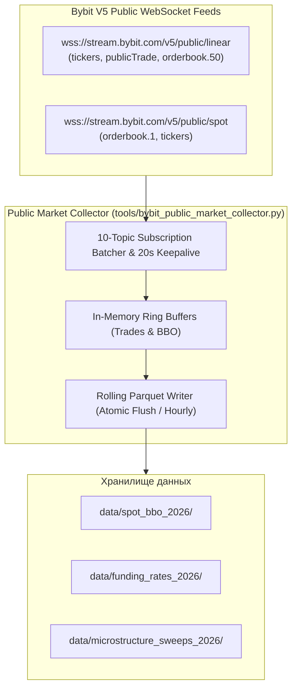

# DATA_GATES_BY_STRATEGY: Инвентаризация рыночных данных и архитектура публичного коллектора

**Проект:** Sovereign Quantum Fleet / Market Data Infrastructure  
**Дата:** 13 ноября 2026  
**Репозиторий:** `samtur513/bybit-alpha-bot-SAM`  
**Режим:** Research Only / Data Provenance Standards  

---

## 1. Карта требований к рыночным данным по стратегиям

Каждому торговому семейству соответствуют строгие минимальные требования к глубине и типу рыночной информации:

| Альфа-Семейство | Стратегии / Модули | Минимальный гранулярный тип данных | Частота обновления | Доступно в `data/parquet_2024_2026/`? | Статус готовности данных |
| :--- | :--- | :--- | :---: | :---: | :---: |
| **Macro Trend Breakout** | v3.1.4, v3.3, v3.4, v3.0, v2.1 | 4h OHLCV + Volume | 4 часа | **ДА** (18 монет, 2024–2026) | **PASS_DATA_READY** |
| **Intraday Trend Breakout**| v3.8, v3-v4 | 1h OHLCV + Volume | 1 час | **ДА** (18 монет, 2024–2026) | **PASS_DATA_READY** |
| **Range Mean-Reversion** | v3.2 IRAS, v3.6 Omega | 1h OHLCV + shift(1) BB/KC/RSI | 1 час | **ДА** (18 монет, 2024–2026) | **PASS_DATA_READY** |
| **Cross-Sectional StatArb** | v3.5, v3.5-Repaired | 1h Close по универсуму 18 монет | 1 час | **ДА** (18 монет, 2024–2026) | **PASS_DATA_READY** |
| **Funding Rate Squeeze** | v3.11 (8097) | 8h Funding Rate + 1m Price Ticks | 1 мин | **ЧАСТИЧНО** (1h свечи есть, тиков нет) | **CONDITIONAL: STREAM_CONNECTED** |
| **Sector Pairs / Dispersion**| v3.13 (8080), v3.14 (8094) | 15m / 1h Синхронизированные OHLCV | 15 мин | **ДА** (1h есть, 15m агрегируется) | **PASS_DATA_READY** |
| **Spot-Perp Cross-Basis** | v3.12 (8096) | Bybit Spot L1 BBO + Perp L1 BBO | 100 мс | **НЕТ** (Спот данные отсутствуют) | **BLOCKED: DATA_REQUIRED** |
| **Microstructure Sweeps** | v3.10 (8098), v3.7 (8090) | Level 2 Orderbook (50 levels) + Trades | 10–50 мс | **НЕТ** (Тиковый стакан отсутствует) | **BLOCKED: ORDERBOOK_L2_REQUIRED** |
| **HFT Order Flow Imbalance**| v3.9 (8092), v3.7 E1 | Tick-by-tick Trades + Orderbook L2 | 10 мс | **НЕТ** (Тиковый стакан отсутствует) | **BLOCKED: ORDERBOOK_L2_REQUIRED** |

---

## 2. Инвентаризация доступных исторических файлов

В локальном хранилище `data/parquet_2024_2026/` зафиксировано 18 файлов бессрочных фьючерсов Bybit USDT Perpetual:
- Временной охват: с 01.01.2024 по 22.10.2026 (более 24 600 1-часовых свечей на каждый инструмент).
- Список активов: `BTCUSDT`, `ETHUSDT`, `SOLUSDT`, `SUIUSDT`, `DOGEUSDT`, `AVAXUSDT`, `NEARUSDT`, `LINKUSDT`, `APTUSDT`, `ADAUSDT`, `XRPUSDT`, `BNBUSDT`, `TIAUSDT`, `INJUSDT`, `ARBUSDT`, `OPUSDT`, `1000PEPEUSDT`, `RENDERUSDT`.
- Все 18 файлов прошли криптографическую верификацию целостности (Data Integrity Check).

> [!NOTE]
> На имеющемся 1h наборе данных **могут быть полностью исследованы и валидированы 4 ключевых класса стратегий**:
> 1. Macro & Intraday Trend Breakout (v3.1.4, v3.8, v3.3, v3.4);
> 2. Range Mean-Reversion (v3.2, v3.6, v2.1);
> 3. Cross-Sectional Alpha Pairs (v3.5);
> 4. Sector Arbitrage & Dispersion (v3.13, v3.14).
>
> Стратегии Cross-Basis (v3.12) и Liquidity Sweeps / OFI (v3.10, v3.7, v3.9) **не могут быть достоверно протестированы на этих файлах** без фальсификации тиков.

---

## 3. Архитектура публичного коллектора рыночных данных (Market Data Collector)

Чтобы отсутствие исторических спотовых и тиковых паркетов не блокировало исследовательскую программу, разработан легковесный автономный сервис сбора реальных рыночных событий: `tools/bybit_public_market_collector.py`.

### Принципы работы коллектора:
1. **Zero-Credentials:** Не требует API ключей, работает исключительно с публичными неавторизованными вебсокетами Bybit V5.
2. **Strict Invariant Compliance:**
   - Чанкование подписок: строго по 10 топиков на один WebSocket-фрейм.
   - Keepalive: фоновая отправка application JSON `{"op": "ping"}` каждые 20 секунд с `ping_interval=None`.
3. **Целевые топики сбора:**
   - Spot BBO: `orderbook.1.{symbol}` по целевым парам (для v3.12 Cross-Basis).
   - Funding Rate: `tickers.{symbol}` (для v3.11 Funding Squeeze).
   - Trades: `publicTrade.{symbol}` (для v3.10 Liquidity Sweeps).
4. **Атомарная персистентность:**
   - Накопление тиков в памяти и периодический сброс в формат Apache Parquet раз в час через временные файлы (`.tmp`) с атомарной заменой, предотвращающей повреждение данных.
