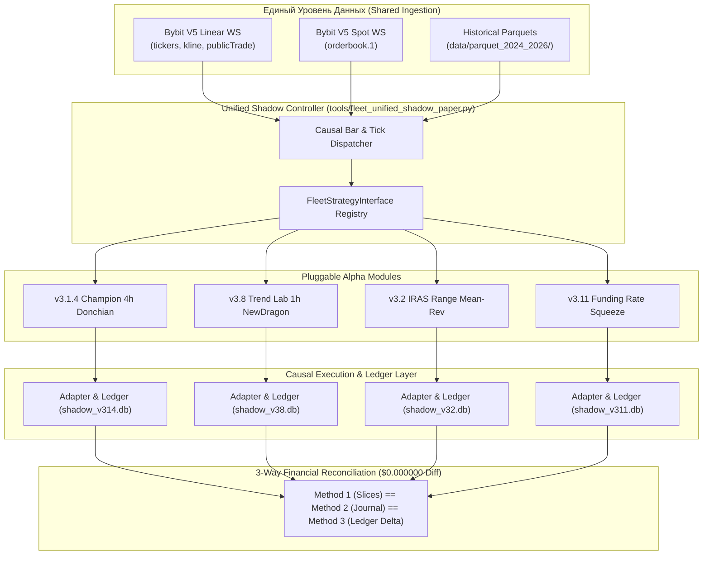

# FLEET_SHADOW_PAPER_READINESS: Архитектура единого лёгкого контура Shadow Paper V2

**Проект:** Sovereign Quantum Fleet / Multi-Alpha Production Freeze  
**Дата:** 13 ноября 2026  
**Репозиторий:** `samtur513/bybit-alpha-bot-SAM`  
**Режим:** Research Only / Zero Real Orders / Zero VPS Restarts  

---

## 1. Архитектурный обзор лёгкого контура

В соответствии с директивой **FLEET-ALPHA-DISCOVERY-004**, разработана единая модульная система параллельного исполнения независимых торговых стратегий — [`tools/fleet_unified_shadow_paper.py`](file:///c:/projects/Torg_Bot_3%20-Antigraviti/tools/fleet_unified_shadow_paper.py).

Система исключает запуск 16 тяжёлых демонов и веб-дашбордов на VPS. Вместо этого все исследовательские альфа-гипотезы работают как легковесные плагины к единому контуру данных, соблюдая абсолютную бухгалтерскую и причинно-следственную изоляцию.



---

## 2. Стандарты изоляции и финансовой верификации

Каждая подключённая стратегия строго подчиняется пяти инвариантам:
1. **Индивидуальный `run_id` и база данных:**
   Каждая стратегия пишет исключительно в свой изолированный файл SQLite (`shadow_<strategy_id>.db`). Обнуление или перезапуск одной стратегии не затрагивает другие.
2. **Изолированный капитал $300.00:**
   Никакого общего пула эквити. Каждая стратегия стартует с выделенными $300.00 виртуального депозита.
3. **Строгая временная причинность (Causal Sequence):**
   $$\text{bar\_start\_ts} < \text{bar\_close\_ts} \le \text{signal\_ready\_ts} \le \text{data\_received\_ts} \le \text{order\_submit\_ts} \le \text{fill\_ts}$$
   Вход в сделку рассчитывается на закрытии бара $t$, а ордер исполняется строго на следующем баре $Open_{t+1}$ (для Market) или при пробитии лимитной цены $Low_{t+1} \le Limit$ (для Maker).
4. **Трёхфакторная бухгалтерская сверка (3-Way Reconciliation):**
   - Метод 1: Сумма PnL закрытых срезов позиций + Funding.
   - Метод 2: Журнал финансовых событий (`REALIZED_PNL` + `TRADING_FEE` + `FUNDING_SETTLEMENT`).
   - Метод 3: Итоговый баланс счёта Ledger.
   - Требование приёмки: **расхождение $\le \$0.00001$ (PASS_PENNY_PERFECT)**.
5. **Маркировка происхождения:**
   - Исторические прогоны: тег `HISTORICAL_REPLAY`.
   - Живой публичный поток: тег `REAL_STREAM`.
   - Симулированные исполнения: тег `SCENARIO_ONLY`.

---

## 3. Очерёдность подключения альфа-гипотез (Activation Roadmap)

| Очередь | Модуль / Стратегия | Причина подключения | Данные | Готовность |
| :---: | :--- | :--- | :---: | :---: |
| **Tier 1 (Active)** | **v3.1.4 Champion 4h** | Минимальный комиссионный drag, стабильный макро-пробой. | 4h OHLCV | **READY NOW** |
| **Tier 1 (Active)** | **v3.8 Trend Lab 1h** | Устранён mock ADX, честный 1R sizer, 4-Stage NewDragon FSM. | 1h OHLCV | **READY NOW** |
| **Tier 2 (Next)** | **v3.11 Funding Squeeze** | Независимый фактор (Carry & Short Squeeze). Устранён хардкод TFI. | WS Tickers | **READY (Подключить к WS)** |
| **Tier 2 (Next)** | **v3.2 IRAS Range Maker** | Отрицательно коррелирует с трендом, собирает премию за флэт. | 1h OHLCV | **READY (Causal next_bars)** |
| **Tier 3** | **v3.10 Master Sweeps** | Качественные признаки ($K_{abs}$, Anti-Compression, TCA). | Public Trades | **CONDITIONAL (Нужен Trades фид)** |
| **Tier 4** | **v3.13 Sector Arbitrage** | 2-ногий статистический арбитраж внутри секторов. | 15m Multi | **CONDITIONAL (2-ногий OMS)** |
| **Tier 5** | **v3.12 Cross-Basis** | Спот-фьючерсный базис. Требует спотовой ноги и порога $\ge 40$ bps. | Spot + Perp | **RESEARCH ONLY** |

---

## 4. Инструкция по независимому запуску и верификации

```bash
# 1. Запуск инвариантных тестов единого контура Shadow Paper
python -m pytest tests/test_fleet_shadow_paper.py -v

# 2. Запуск тестов публичного коллектора данных Bybit V5
python -m pytest tests/test_bybit_public_market_collector.py -v

# 3. Полный сквозной прогон всей регрессионной батареи флота
python -m pytest tests/test_fleet_execution_contract.py tests/test_fasttrack_003_invariants.py tests/test_signal_parity_native.py tests/test_fleet_shadow_paper.py tests/test_bybit_public_market_collector.py -v
```
