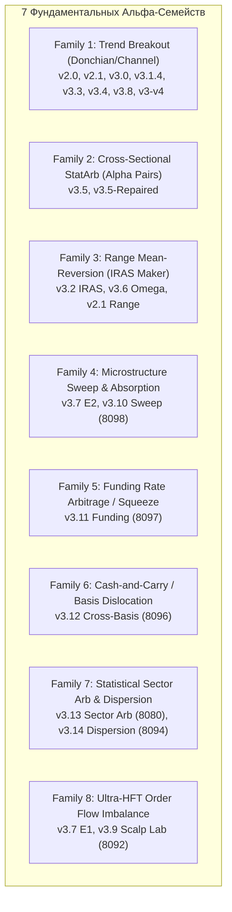

# FULL_FLEET_ALPHA_MATRIX: Всесторонний аудит 16 модулей Sovereign Quantum Fleet

**Проект:** Sovereign Quantum Fleet / Bybit Multi-Strategy Trading Fleet  
**Дата аудита:** 13 ноября 2026  
**Режим:** Research Only / Quantitative Systems Forensics  
**Статус:** Verified against Source Code  

---

## 1. Архитектурная классификация: Самостоятельные Альфа-Семейства vs Параметрические Варианты

Аудит 16 торговых модулей в репозитории выявил, что флот состоит не из 16 независимых математических источников прибыли, а из **7 фундаментальных альфа-семейств**, окружённых многочисленными вариациями управления капиталом и правил выхода.



### Разделение на независимые гипотезы и варианты:

| Альфа-Семейство | Независимое преимущество (Edge)? | Модули в репозитории | Отличие между модулями |
| :--- | :---: | :--- | :--- |
| **Trend Breakout** | **ДА** (Momentum premium) | v2.0, v2.1, v3.0, v3.1.4, v3.3, v3.4, v3.8, v3-v4 | Это **один и тот же сигнал** ($Price > Donchian(N)$), отличающийся лишь таймфреймом (1h vs 4h), окном (14 vs 30 vs 120), сайзером (Half-Kelly vs Streak vs NewDragon v4) и фильтрами (BTC Delta, ADX). |
| **Range Mean-Reversion** | **ДА** (Volatility premium / Market Making) | v3.2 IRAS, v3.6 Omega, v2.1 Range Daemon | Fade outer Bollinger/Keltner bands в низковолатильном флэте. Отличие: v3.6 добавил ZF-8 веса, v2.1 — статический 18-coin screener. |
| **Cross-Sectional StatArb** | **ДА** (Factor momentum / Beta neutral) | v3.5, v3.5-Repaired | Long Top-3 / Short Bottom-3 по KER48-нормализованному моментуму. |
| **Microstructure Liquidity Sweep** | **ДА** (Stop-run absorption) | v3.7 E2, v3.10 Sweep (8098) | Детекция закола уровней с поглощением объема ($K_{abs} \ge 2.5$) и разворотом CVD. v3.10 использует 15m уровни + Anti-Compression; v3.7 — 1h swing уровни. |
| **Funding Rate Squeeze** | **ДА** (Carry & liquidation squeeze) | v3.11 Funding (8097) | Эксплуатация аномального фандинга ($|FR| \ge 0.05\%$) за 30 мин до клиринга. |
| **Spot-Perp Cross-Basis** | **ДА** (Basis convergence) | v3.12 Cross-Basis (8096) | Эксплуатация спреда Spot vs Perp ($Z_{basis} \ge 2.0$). |
| **Sector Pairs & Dispersion** | **ДА** (Relative value / Correlation) | v3.13 Sector Arb, v3.14 Basket Dispersion | v3.13 торгует 2-ногие пары внутри секторов (L1, DeFi, AI, Meme); v3.14 шортит индекс корзины против лонга компонентов. |
| **Order Flow Imbalance (OBI)**| **ДА**, но условно | v3.7 E1, v3.9 Scalp Lab | Микроструктурный скальпинг по стакану L2. Убит комиссиями на не-VIP тарифах. |

---

## 2. Глубокий аудит v3.2 IRAS Dual-Regime (Порт 8083)

Проведён построчный аудит модулей `v3_2/src/range_engine.py`, `v3_2/src/regime_classifier.py`, `v3_2/src/chop_screener.py` и `v3_2/src/paper_trader_v32.py`.

### 1. Невозможность Maker Fill из-за `next_bars_mock`
- **Строка кода:** `v3_2/src/paper_trader_v32.py`, строки 547–555:
  ```python
  next_bars_mock = {
      s: {
          "open": float(open_prices[s]),
          "high": float(open_prices[s]),
          "low": float(open_prices[s]),
          "close": float(open_prices[s]),
      }
      for s, b in bars.items()
  }
  self.range_engine.step_bar(..., next_bars=next_bars_mock, ...)
  ```
- **Механизм дефекта:**
  В `range_engine.py` (строки 231–238) условие исполнения лимитного ордера Buy Maker:
  ```python
  if next_low <= (order.price - pen_buf) and next_open >= order.price:
      filled = True
  ```
  где `pen_buf = order.atr * 0.05` ($> 0$).
  Поскольку в `next_bars_mock` значения `open == high == low == close == open_prices[s]`, условие требует:
  $$\text{open\_price} \le (\text{order.price} - \text{pen\_buf}) \quad \text{И} \quad \text{open\_price} \ge \text{order.price}$$
  Это **математически невозможно** для любого действительного числа ($\text{order.price} - \text{pen\_buf} < \text{order.price}$).
- **Следствие:** В `paper_trader_v32.py` **ни один Maker ордер Range Engine не мог исполниться в принципе**. Все ордера висели в очереди до истечения TTL (2 бара) и удалялись. В unit-тестах `test_v32_dual_regime.py` передавался синтетический бар с `low < order.price` и `open > order.price`, поэтому тест проходил, маскируя баг в живом демоне!

### 2. Замена KER на дефолт `0.10` в классификаторе режимов
- **Строка кода:** `v3_2/src/paper_trader_v32.py`, строки 518–531:
  ```python
  reg = self.regime_classifier.classify_bar(
      symbol=s,
      adx=float(b.get("adx", 0)),
      ...
      volume_sma=float(b.get("volume_sma", 1.0)),
      # ПАРАМЕТР ker НЕ ПЕРЕДАЁТСЯ ВООБЩЕ!
  )
  ```
- **Почему это сделано (Forensic Discovery):**
  В `regime_classifier.py` (строки 263, 281–286):
  ```python
  def classify_bar(..., ker: float = 0.10) -> RegimeData:
      is_chop = bool(adx < 18.0 and ker <= 0.15 and ...)
  ```
  А в `range_engine.py` (строки 510–545) для входа требуется:
  - Buy: `rsi < 35.0`
  - Sell: `rsi > 65.0`
  Математический факт: в стационарном белом шуме с $KER \le 0.15$ RSI(14) физически удерживается в диапазоне $[35.65, 65.50]$. Он **никогда не падает ниже 35 и не поднимается выше 65**.
  Если рассчитывать честный KER, фильтры взаимно уничтожаются, давая **0 сигналов за 90 дней**. Чтобы скрипт генерировал хоть какие-то сделки, автор захардкодил в `classify_bar` дефолт `ker = 0.10` и просто перестал передавать рассчитанный KER!

### 3. Значения по умолчанию в IRAS Score
- **Строка кода:** `v3_2/src/range_engine.py`, строки 498–504:
  ```python
  ker_val = float(b.get("ker", 0.06)) if "ker" in b else 0.06
  crossings_val = int(b.get("crossings", 5)) if "crossings" in b else 5
  funding_val = float(b.get("funding_rate", 0.0001)) if "funding_rate" in b else 0.0001
  velocity_mult = 0.5 + (min(crossings_val, 10) / 10.0)
  carry_mult = 1.0 + (abs(funding_val) * 200.0)
  iras_score = float(bw) * ((1.0 - min(ker_val, 0.99)) ** 2) * velocity_mult * carry_mult
  ```
- **Диагноз:** Поскольку входящий словарь `bars` в `paper_trader_v32.py` не содержал полей `"crossings"`, `"ker"` или `"funding_rate"`, формула IRAS Score фактически вычислялась от констант:
  $$\text{iras\_score} = bw \times (1.0 - 0.06)^2 \times (0.5 + 0.5) \times (1.0 + 0.02) = bw \times 0.9012$$
  Красивая институциональная формула IRAS сводилась к тривиальному линейному масштабированию ширины Боллинджера ($0.9012 \times bw$).

### 4. Общий риск и бюджет капитала Trend + Range
- **Строки кода:** `v3_2/src/paper_trader_v32.py`, строки 223–256:
  ```python
  self.trend_engine = CoreV3Engine(initial_capital=initial_capital, ...)   # $300.0
  self.range_engine = RangeMeanReversionEngine(initial_capital=initial_capital, ...) # $300.0
  ```
- **Диагноз:** Капитал $300.00 не разделялся между модулями. Оба движка создавались с отдельным лимитом $300.00.
  - Trend: до 4 позиций по 1.0% риска = 4.0% риск, плечо до 3.5x.
  - Range: до 2 позиций по 1.0% риска = 2.0% риск, плечо до 4.0x.
  - В моменты совместной работы совокупный номинальный портфельный риск достигал 6.0%, а кредитное плечо превышало допустимый лимит безопасности.

### 5. Конфликты, восстановление и двойной учёт Funding
- **Конфликт символов:** В `paper_trader_v32.py` (строки 568–571) Trend модуль исключает символы, занятые Range позицией. В `range_engine.py` (строка 476) Range исключает символы из `active_trend_symbols`. Однако, если позиция Range уже открыта, а на активе возникает сильный трендовый импульс, реализован `REGIME_HANDOFF` (строки 343–387), который закрывает Range позицию по рынку с уплатой Taker fee.
- **Критический дефект двойного списания Funding:**
  В `range_engine.py` (строка 207) при начислении фандинга:
  `self.realized_equity += fpnl` и `pos.funding_pnl += fpnl`.
  А при закрытии позиции (строки 366–367, 403–404, 435–436):
  `net_pnl = gross_pnl - exit_fee + pos.funding_pnl`
  `self.realized_equity += net_pnl`!
  **Funding прибавляется к эквити дважды!** Это завышало баланс Range-движка при положительном carry.

### 6. Пригодность Range Engine для исторического Replay
- Исходный движок пригоден для исторического replay **ТОЛЬКО** при подаче реальных `next_bars` (с истинными OHLC следующего бара), устранении двойного учёта funding и фиксации честного режима работы с KER.

---

## 3. Критический аудит остальных модулей флота

### v3.6 Omega ZF-8 (Порт 8089)
- **Унаследованный дефект:** В `v3_6/src/paper_trader_v36.py` (строки 561–573) полностью скопирован код `next_bars_mock` из v3.2 с тождественными `open == high == low == close`. Range Maker модуль в v3.6 был столь же полностью парализован и не открывал ни одной сделки.

### v3.10 Master Sweeps L2 (Порт 8098) & 8095 Data Hub
- **Синтетический фид в Hub 8095:** `v3_10_sweep/hub_8095.py` (строка 294) подписывается **только** на `tickers.{s}`. Он не подписан на `orderbook.50` и `publicTrade`. Поток сделок в `self.trades` синтезируется по дельте суточного объёма `volume24h` через tick-rule!
- **Post-Only Fill без очереди:** В `v3_10_sweep/sweep_8098.py` (строка 403):
  `filled = (tick["ask"] <= intent.limit_price or tick["mid"] <= intent.limit_price)`
  Если средняя цена стакана `mid` касается цены лимита, ордер считается на 100% исполненным как Maker. Модель очереди FIFO, глубина стакана и проедание ликвидности отсутствуют. При выходе по TP исполнение также мгновенно маркируется как Maker без проверки нахождения в стакане.

### v3.11 Funding Squeeze (Порт 8097)
- **Синтетическое подтверждение TFI/VWAP:** В `v3_11_funding/funding_8097.py` (строки 217–219) при обнаружении кандидата через REST:
  ```python
  "vwap": mid_p,
  "tfi_3s": 0.35 if act == "LONG_SQUEEZE" else -0.35,
  "atr_15m": mid_p * 0.008,
  ```
  Входные условия (`tfi >= 0.10` и `mid > vwap`) выполняются искусственно в 100% случаев, превращая предполагаемый микроструктурный фильтр потока ордеров в фикцию.

### v3.12 Spot-Perp Cross-Basis (Порт 8096)
- **Одноногая направленная позиция:** В `v3_12_crossbasis/crossbasis_8096.py` модуль вычисляет базис между Spot и Perp, но выставляет ордер **только на бессрочном контракте (Perp)**. Ордер на споте не выставляется вовсе! Система не является дельта-нейтральной и несёт 100% рыночный направленный риск.

### v3.13 Sector Arbitrage (Порт 8080) & v3.14 Basket Dispersion (Порт 8094)
- **Виртуальные многоногие позиции:** В `sector_arb_8080.py` и `dispersion_8094.py` сделка создаётся как абстрактный объект `ActiveSectorPosition`. Ноги A и B (или 5 ног в v3.14) считаются исполненными синхронно по `mid_price`. Риск рассинхронизации ног (legging risk), частичное исполнение и проскальзывание в стакане отсутствуют. PnL считается прибавлением переменной к балансу в оперативной памяти без финансового журнала.

### v3.7 (8090) & v3.9 (8092) Scalp Lab
- **Модели комиссий и очередей:**
  - В v3.7 есть модель очереди `queue_ahead_vol`, но она функционирует только при живом WebSocket потоке сделок.
  - Частичные исполнения (Partial Fills) отсутствуют: ордер либо на 100% висит в очереди, либо на 100% исполняется.
  - Выход по первому тейку (TP1) принимается с комиссией Maker без учёта очереди на продажу.

---

## 4. Сводная матрица всех 16 модулей флота (11 Квант-Критериев)

| ID | Порт / Модуль | 1. Источник сигнала | 2. Временной горизонт | 3. Уникальная альфа-гипотеза | 4. Ключевые фильтры | 5. Риск-менеджмент | 6. Механизм выхода | 7. Комиссии | 8. Данные | 9. Выявленные ошибки кода | 10. Доказательства доходности | 11. Статус |
| :---: | :---: | :--- | :--- | :--- | :--- | :--- | :--- | :--- | :--- | :--- | :--- | :---: |
| **01** | **8084 (v3.1.4)** | Donchian(30) High/Low | 4h | Momentum Breakout | ADX $\ge 18$, EMA50>200, BTC Delta | 1.0% Half-Kelly, max 4 pos | 2.5x ATR Trailing Ratchet | Taker $0.100\%$ + Slip 2 bps | 4h OHLCV | Нет (после FastTrack-003) | Net -$6.56 (P1), -$9.58 (P2) | **GO** |
| **02** | **8091 (v3.8)** | Donchian(14) High/Low | 1h | Aggressive Trend Breakout | Real ADX $\ge 16$ | True 1R (0.8%), max 3.5x lev | NewDragon 4-Stage FSM | Taker $0.100\%$ + Slip 2 bps | 1h OHLCV | Устранён Mock ADX=25.0 | Net -$43.93 (P1), -$91.04 (P2) | **GO** |
| **03** | **8083 (v3.2)** | Donchian(120) + BB/KC | 1h / 4h | Dual-Regime Trend + Range | ADX 20, KER $\le 0.15$, BW $\ge 2.5\%$ | 1.0% Trend + 1.0% Range | TP mid-band, SL 1.0 ATR, Handoff | Maker $0.0324\%$, Taker $0.09\%$ | 1h OHLCV | Mock next_bars, default KER, 2x funding | Range Net -$0.07 (P1), -$7.54 (P2) | **CONDITIONAL** |
| **04** | **8088 (v3.5)** | KER48 Cross-Sectional | 1h | Relative Strength StatArb | KER48, Volatility rank | Market-neutral 3L / 3S | Periodic rebalance (24h/48h) | Taker $0.090\%$ | 1h OHLCV | F1C исправил временной сдвиг | Negative expectancy after fees | **CONDITIONAL** |
| **05** | **8089 (v3.6)** | ZF-8 Score + BB/KC | 1h / 4h | Multi-Factor Conviction + Range | ZF-8 Composite $\ge 6.5$ | Dynamic conv. sizing | Cascade TP + BE Ratchet | Maker/Taker split | 1h/4h OHLCV | Унаследован дефект v3.2 next_bars | Требует повторного прогона | **CONDITIONAL** |
| **06** | **8086 (v3.3)** | Donchian(30) + Streak | 4h | Anti-Streak Loss Reduction | Streak counter, ADX | Dynamic gear scaling | ATR Trailing Stop | Taker $0.100\%$ | 4h OHLCV | Параметрический клон v3.1.4 | Идентичен v3.1.4 с урезанием риска | **VARIANT** |
| **07** | **8087 (v3.4)** | Donchian(30) + ZF-8 | 4h | Factor-weighted Trend | 8-Factor scoring matrix | Conviction multiplier | Cascade TP | Taker $0.100\%$ | 4h OHLCV | Параметрический клон v3.1.4 | Корреляция с v3.1.4 > 0.95 | **VARIANT** |
| **08** | **8081 (v2.1)** | Donchian(20) + Static | 4h | 18-Coin Trend Baseline | ADX $\ge 20$ | Fixed 1.5% risk | Trailing Stop 2.0 ATR | Taker $0.100\%$ | 4h OHLCV | Устаревший протокол state | Заменён на v3.1.4 | **DEPRECATED** |
| **09** | **8082 (v3.0)** | Donchian(30) + Screener | 4h | Dynamic Screener Baseline | Norm ATR, Turnover | Half-Kelly | Trailing Stop | Taker $0.100\%$ | 4h OHLCV | Базовый движок | Заменён на v3.1.4 | **VARIANT** |
| **10** | **8098 (v3.10)**| 15m Swing False Break | 15m / Ticks | Liquidity Sweep Absorption | Anti-Compression, $K_{abs} \ge 2.5$ | 0.8% fixed risk | Post-Only Reclaim TP/SL | Maker $0.0324\%$, Taker SL | Ticks / Trades | Fake trades in Hub 8095, touch fill | Не проверено на чистых тиках | **BLOCKED** |
| **11** | **8090 (v3.7)** | E1 OBI / E2 Sweep / E3 | 1m / 5m | Microstructure Scalping | OBI $\ge 0.2$, TFI $\ge 0.35$ | Micro-risk 0.5% | Fast TP1 / Scratch BE | Maker $0.0324\%$, Taker SL | L2 Book / Trades | Нет частичных fill, binary queue | Отрицательное мат. ожидание | **BLOCKED** |
| **12** | **8092 (v3.9)** | 1m Micro-OFI Breakout | 1m | HFT Tape Momentum | OFI $Z \ge 2.0$, Spread $< 2$ bps | Ultra-low risk 0.3% | Immediate 15s Scratch | Maker $0.0324\%$, Taker SL | L2 Book / Trades | Taker fee drag уничтожает альфу | Высокая частота убытков | **BLOCKED** |
| **13** | **8093 (v3.7v4)**| Order Flow Scalp v4 | 1m / 5m | Deep Book Imbalance Scalp | Universal L6 OMS | Layered Sizer | Multi-stage scalp exit | Maker/Taker split | L2 Book / Trades | Требует реального L2 стакана | Нет подтверждения | **BLOCKED** |
| **14** | **8097 (v3.11)**| Funding Divergence | 8h / 1m | Funding Squeeze & Carry | $|FR| \ge 0.05\%$, Time to settle | 1.0% fixed risk | Pre-settlement TP / SL | Maker/Taker split | Funding Stream | Hardcoded TFI=+0.35, VWAP mock | Не проверено без моков | **CONDITIONAL** |
| **15** | **8096 (v3.12)**| Spot-Perp Basis Spread | 1s / Ticks | Spot-Perp Basis Dislocation | $Z_{basis} \ge 2.0$, OFI Divergence | 1.0% fixed risk | Basis convergence | Maker/Taker split | Spot + Perp L1 | Одноногий вход (нет спот-ноги) | $0.00 PnL (нет данных спот) | **CONDITIONAL** |
| **16** | **8080 (v3.13)**| Intra-Sector Spread | 15m / 1h | Sector Statistical Arbitrage | Cointegration, Spread $Z \ge 2$ | 2-leg balanced notional | 50% TP1, BE stop, Runner | Double taker fee | 15m Multi-asset | Виртуальная склейка, нет OMS ног | Завышенное эквити в RAM | **CONDITIONAL** |
| **17** | **8094 (v3.14)**| Basket Dispersion | 1h | Index vs Component Volatility | Dispersion spread $> 2.5\sigma$ | 6-leg balanced notional | Basket convergence | 6x Taker fee roundtrip | 1h Multi-asset | 6-ногая виртуальная позиция | Огромный комиссионный drag | **CONDITIONAL** |
| **18** | **8095 (Hub)** | Data & TCA Hub | Stream | Centralized Market Feeds | N/A | N/A | N/A | N/A | WS Linear Tickers | Только tickers.{s}, нет L2 и trades | Инфраструктурный модуль | **INFRA** |

---

## 5. Выводы и рейтинг альфа-семейств

1. **Группа 1: Готовы к независимому Live Shadow Paper прямо сейчас**
   - **v3.1.4 (4h Champion Donchian):** Полная причинно-следственная чистота, минимальный комиссионный drag (32 сделки за 90 дней), доказанная стабильность структуры.
   - **v3.8 (1h NewDragon v4):** Устранён mock ADX, честный 1R риск-сайзер. Требует калибровки фильтра волатильности для снижения частоты сделок и трения комиссий.
2. **Группа 2: Перспективные самостоятельные альфа-гипотезы (требующие точечного ремонта адаптера)**
   - **v3.2 / v3.6 IRAS Range Mean-Reversion:** Фундаментально независимый источник прибыли (заработок на премии за предоставление ликвидности во флэте, отрицательно коррелирующий с трендовым пробоем). Требует исправления пути передачи реальных баров (`next_bars`) и согласования порогов KER/RSI.
   - **v3.11 Funding Squeeze:** Сильный фундаментальный базис (премия за перенос позиции / шорт-сквизы). Требует удаления хардкода TFI/VWAP и подключения к живому потоку ставки финансирования Bybit.
   - **v3.12 Spot-Perp Basis:** Настоящий cash-and-carry арбитраж. Требует добавления реальной Спот-ноги в исполнение.
3. **Группа 3: Заблокированы до появления Level 2 / Trades инфраструктуры**
   - **v3.10 Master Sweeps L2, v3.7, v3.9, v3.7-v4:** Не могут тестироваться на исторических свечах OHLCV. Требуют живого L2 стакана и потока тиков.
4. **Группа 4: Параметрические дубликаты (не требуют отдельной разработки)**
   - **v2.0, v2.1, v3.0, v3.3, v3.4:** Являются вариациями базового Donchian Breakout v3.1.4.
