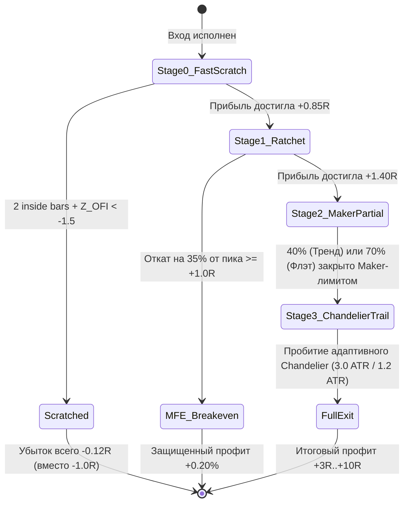

# Torg_Bot Sovereign Quantum Alpha (v4.0+)
## Архитектурная спецификация идеальной квантовой торговой системы
*Разработано для Bybit V5 Linear Perpetuals: Мульти-альфа, Мульти-режимность, Депозитарная адаптивность ($100 – $100,000+)*

---

## 1. Архитектурная философия: Принцип Трехмерной Ортогональности

Большинство алгоритмических систем на рынке терпят крах по фундаментальной причине: они **одномерны** и оптимизированы под один класс рыночных условий:
* **Трендовые системы (Trend-Following)**: генерируют высокую прибыль на направленных ралли, но полностью сливают накопленный капитал в затяжных 6-месячных боковиках (пилорамах).
* **Сеточные и маркет-мейкинг системы (Grid / Mean-Reversion)**: генерируют стабильный денежный поток в боковиках, но испытывают фатальные просадки и ликвидации при мощных безоткатных трендах или структурных обвалах.
* **Арбитражные системы (Stat-Arb / Funding Arbitrage)**: страдают от расширения спредов, токсичного потока ордеров и комиссионного истощения (Fee Drag).

**Sovereign Quantum Alpha (v4.0+)** объединяет три взаимно ортогональных источника прибыли (альфы), корреляция между которыми стремится к нулю:

```
               ▲ НАПРАВЛЕННАЯ АЛЬФА (Directional Trend)
               │ [Движок A: Donchian 4h/1h + Pyramiding]
               │ [Движок D: News Elasticity & Sympathy]
               │
               │               ▲ РЫНОЧНО-НЕЙТРАЛЬНАЯ АЛЬФА (Market-Neutral)
               │              /  [Движок B: IRAS Range Maker M5/M15]
               │             /   [Движок C: Zero-Beta Sector Stat-Arb]
               │            /    [Funding Carry & Velocity Oracle]
               │           /
               ───────────┼─────────────────────────────────►
                         /  СОБЫТИЙНАЯ И ЛИКВИДАЦИОННАЯ АЛЬФА
                        /   [Движок E: Hawkes Liquidation Hunter]
                       /    [VPIN Toxicity Absorption]
```

1. **Направленная альфа (Directional Momentum & Pyramiding)**: извлечение асимметричной прибыли (+3R...+10R) из редких экспоненциальных рыночных ралли с жестким отсечением ложных пробоев.
2. **Рыночно-нейтральная структурная альфа (Market-Neutral & Microstructure Spreads)**: генерация постоянного ежедневного денежного потока из рыночных дисбалансов (внутрисекторальные спреды, коинтеграция, отрицательные комиссии Maker, сбор аномального фандинга), полностью изолированная от направления Bitcoin.
3. **Асимметричная событийная альфа (Event & Liquidation Absorption)**: перехват институционального вакуума ликвидности и лавинообразных каскадов принудительного закрытия маржинальных позиций розничных трейдеров.

---

## 2. Сквозная пятиуровневая архитектура системы

```mermaid
flowchart TD
    subgraph L1["Уровень 1: Всевидящая Сенсорная Сеть (Omniscient Data Grid)"]
        D1["Dynamic Universe Screener<br/>(400+ Perps: Turnover, Vol, KER, RS)"]
        D2["Microstructure Order Flow Radar<br/>(L2 Depth, Z_OFI, Stoikov Micro-Price)"]
        D3["Cascade & Toxicity Engine<br/>(VPIN + Hawkes Liquidation Process)"]
        D4["News NLP & Sympathy Graph<br/>(Катализаторы & Межассетный лаг)"]
        D5["Funding & Basis Oracle<br/>(Pre-Funding Velocity, Rate Resets)"]
    end

    subgraph L2["Уровень 2: Квантовый Супервизор Режимов (The Maestro)"]
        M1["Causal Regime Detector<br/>(Zero-Lookahead 3-State HMM + Hurst)"]
        M2["Macro News Embargo Shield"]
        M3["Dynamic Capital Allocator<br/>(Risk Budgeting & ZF-8 Gearbox)"]
    end

    subgraph L3["Уровень 3: Мульти-Альфа Фабрика (5 Движков)"]
        E1["Движок A: Sovereign Trend Runner<br/>(H4/H1 Donchian + Pyramiding)"]
        E2["Движок B: IRAS Structural Range Maker<br/>(M5/M15 Mean-Reversion Post-Only)"]
        E3["Движок C: Zero-Beta Sector Stat-Arb<br/>(Kalman Dynamic Cointegration)"]
        E4["Движок D: News Elasticity & Sympathy<br/>(N1 Pullback на Altcoin-Beta)"]
        E5["Движок E: Hawkes Liquidation Hunter<br/>(VPIN Toxicity Absorption)"]
    end

    subgraph L4["Уровень 4: Депозитарно-Адаптивный Риск-Манифолд"]
        R1["Micro-Account Router<br/>($100–$500: minNotional Guard)"]
        R2["Portfolio Heat & Correlation Cap<br/>(Max Heat 4.5%, Max Cluster 2)"]
        R3["ZF-8 Transmission Control<br/>(Gearing Up on Wins / Limp Mode on DD)"]
    end

    subgraph L5["Уровень 5: Фабрика Безупречного Выхода (Adaptive Exit FSM)"]
        X0["Stage 0: Fast Scratch (-0.12R)"]
        X1["Stage 1: Ratchet Lock & MFE BE"]
        X2["Stage 2: Dynamic Maker Partial (40%/70%)"]
        X3["Stage 3: Adaptive Chandelier Runner (+3R..+10R)"]
    end

    L1 --> L2
    L2 --> L3
    L3 --> L4
    L4 --> L5
```



---

## 3. Детальное описание модулей системы

### Уровень 1: Всевидящая сенсорная сеть и микроструктура (Omniscient Data Grid)

Модуль непрерывно агрегирует потоковые данные Bybit V5 (WebSocket + REST) и строит трехмерную картину ликвидности:

1. **Dynamic Universe Screener (400+ пар Bybit Linear Perps)**:
   * **Периодичность обновления**: каждые 60 минут.
   * **Фильтр ликвидности**: $\text{Turnover}_{24h} \ge \$5{,}000{,}000$, спред топ-книги $\le 0.05\%$.
   * **Нормализованный ATR (NATR)**: $\text{NATR}_{14} = \frac{\text{ATR}_{14}}{\text{Close}} \times 100 \ge 2.2\%$. Отсекает неволатильные активы.
   * **Коэффициент эффективности Кауфмана (KER)**:
     $$\text{KER}_n = \frac{|P_t - P_{t-n}|}{\sum_{i=1}^n |P_i - P_{i-1}|}$$
     Отделяет направленный импульс ($\text{KER} > 0.35$) от случайного блуждания.
   * **Relative Strength (RS vs BTC)**: 24h и 4h альфа монеты относительно биткоина.
2. **Microstructure Order Flow Radar (L2 Order Book & Trades)**:
   * **Z-Score Дисбаланса Потока Ордеров ($Z_{\text{OFI}}$)**: рассчитывает изменения объема на первых 5 уровнях стакана с учетом агрессивных сделок. Выброс $Z_{\text{OFI}} > +2.0$ фиксирует скрытое институциональное накопление до движения цены.
   * **Микро-цена Стойкова (Stoikov Micro-Price)**:
     $$P_{\text{micro}} = P_{\text{bid}} \cdot \frac{Q_{\text{ask}}}{Q_{\text{bid}} + Q_{\text{ask}}} + P_{\text{ask}} \cdot \frac{Q_{\text{bid}}}{Q_{\text{bid}} + Q_{\text{ask}}}$$
     Определяет истинную вероятность направления следующего тика на основе распределения ликвидности.
3. **VPIN & Hawkes Process Liquidation Radar**:
   * **VPIN (Volume-Synchronized Probability of Toxicity)**: агрегирует сделки в корзины равного объёма ($V = 1\%$ от часового объема). Измеряет долю информированного/токсичного потока:
     $$\text{VPIN} = \frac{\sum_{\tau=1}^N |V_\tau^B - V_\tau^S|}{N \times V}$$
     Значение $\text{VPIN} > 0.80$ указывает на доминирование однонаправленного каскада.
   * **Самовозбуждающийся точечный процесс Хокса (Hawkes Process)**:
     $$\lambda(t) = \mu + \sum_{t_i < t} \alpha \cdot e^{-\beta (t - t_i)}$$
     Каждая рыночная ликвидация на Bybit увеличивает вероятность последующих принудительных закрытий. При приближении ветвящегося коэффициента $\eta = \frac{\alpha}{\beta} \to 1.0$ система фиксирует неизбежный взрывной каскад.
4. **Funding Rate & Carry Oracle**:
   * Отслеживает отклонения ставок финансирования Bybit относительно Binance и OKX. Прогнозирует ставку за 15–30 минут до клиринга, выявляя возможности сбора кэрри от 50% до 120% APR.
5. **News NLP & Sympathy Knowledge Graph**:
   * Обработка новостных заголовков и катализаторов задержкой $< 150$ мс.
   * Построение карты межассетной эластичности (Sympathy Contagion): выявление активов второго эшелона, реагирующих на движения лидеров с временным лагом 3–20 секунд.

---

### Уровень 2: Квантовый супервизор режимов («The Maestro»)

Модуль распределяет капитал и активирует нужные альфа-движки в зависимости от физического состояния рынка:

1. **Causal Regime Detector (Zero-Lookahead)**:
   * 3-состоятельная скрытая марковская модель (HMM) в связке с показателем Херста ($H$):
     * **Режим 1: Сильный тренд ($H > 0.58$, KER $> 0.38$)** — импульс преобладает, пробои истинны.
     * **Режим 2: Структурный флэт ($H < 0.42$, KER $< 0.28$)** — преобладает возврат к среднему, пробои ложны.
     * **Режим 3: Токсичный шторм / Режим высокого риска ($\text{VPIN} > 0.75$, всплеск волатильности, новостной шок)**.
2. **Матрица динамического распределения капитала (Risk Budgeting)**:

| Состояние рынка | Движок A (Тренд) | Движок B (Флэт Maker) | Движок C (Stat-Arb) | Движок D (Новости) | Движок E (Ликвидации) | Резерв (Кэш) |
|---|:---:|:---:|:---:|:---:|:---:|:---:|
| **Сильный тренд** | **45%** | 0% | 15% | 20% | 10% | 10% |
| **Структурный флэт**| 5% | **35%** | **35%** | 5% | 10% | 10% |
| **Токсичный шторм** | 0% | 0% | 0% | 15% | **45%** | **40%** |

3. **Коробка передач ZF-8 (Adaptive Gearbox)**:
   * Динамическое масштабирование доли Келли ($f^*$) в зависимости от профиля эквити:
     * **Gears 5–8 (Drive/Overdrive)**: при серии из 3+ прибыльных сделок и просадке $DD < 3\%$ риск на сделку масштабируется до 1.0%–1.2%.
     * **Gears 3–4 (Cruise)**: базовый режим работы (риск 0.65%–0.75%).
     * **Gears 1–2 (Limp Mode)**: при просадке от 5% до 8% риск автоматически режется вдвое (до 0.35%).
     * **Parking (Circuit Breaker)**: при просадке $\ge 10\%$ в рамках дня/недели открытие новых позиций замораживается на 24 часа.

---

### Уровень 3: Пять специализированных альфа-генераторов

```
┌────────────────────────────────────────────────────────────────────────┐
│                   МУЛЬТИ-АЛЬФА ХАБ (5 НЕЗАВИСИМЫХ ДВИЖКОВ)              │
├───────────────────┬───────────────────┬────────────────────────────────┤
│ Движок            │ Рыночный фокус    │ Механика исполнения            │
├───────────────────┼───────────────────┼────────────────────────────────┤
│ A: Trend Runner   │ H4/H1 Ралли       │ Donchian + Pyramiding          │
│ B: Range Maker    │ M5/M15 Боковик    │ Post-Only Maker Лимиты         │
│ C: Stat-Arb       │ Спреды секторов   │ Kalman Cointegration (Beta=0)  │
│ D: News Sympathy  │ Катализаторы      │ N1 Pullback на Altcoin-Beta    │
│ E: Hawkes Hunter  │ Панические шпильки│ Перехват вакуума ликвидаций    │
└───────────────────┴───────────────────┴────────────────────────────────┘
```

#### Движок A: Sovereign Trend Runner (H4/H1 Donchian + Pyramiding)
* **Назначение**: захват крупных направленных движений (+3R...+10R).
* **Вход**: истинный прорыв 20-периодного канала Дончиана на закрытом 4-часовом баре (`shift(1)`).
* **Тройной фильтр**: $\text{ADX} \ge 18.0$, $\text{EMA}_{50} > \text{EMA}_{200}$ (для Long), согласованность с дневным BTC Delta.
* **Антимартингейл Пирамидинг**: добавление до 2 ступеней объема (+1.5R и +3.0R) строго из накопленной нереализованной прибыли с непрерывным расчетом средневзвешенной цены входа (`Weighted Average Entry Price`) и переносом безубытка.

#### Движок B: IRAS Structural Range Maker (M5/M15 Mean-Reversion)
* **Назначение**: заработок на колебаниях цены внутри диапазона при $\text{KER} < 0.28$.
* **Вход**: пассивные **Post-Only Maker лимитные ордера** на отскок от границ волатильности (Bollinger 2.2 std).
* **Комиссионное преимущество**: 100% Maker исполнение ($0.0324\%$ вместо $0.090\%$ taker). При сдвиге микро-цены Стойкова против заявки ордер отменяется до исполнения.

#### Движок C: Zero-Beta Sector Stat-Arb (Парный коинтеграционный арбитраж)
* **Назначение**: абсолютно рыночно-нейтральная прибыль (Portfolio Beta = 0).
* **Пары активов**: внутрисекторальные связки (`SOL/SUI`, `PEPE/WIF`, `NEAR/RENDER`, `PENDLE/ENA`).
* **Фильтр Калмана (Kalman Filter)**: динамический расчет коэффициента хеджирования $\beta_t$ в реальном времени:
  $$\text{Spread}_t = P_{A,t} - \beta_t \cdot P_{B,t}$$
* **Вход**: при отклонении спреда $|Z_{\text{spread}}| \ge 2.2$ (Long недооцененного / Short переоцененного).
* **Выход**: при возврате к среднему ($Z \to 0$). Движения BTC не влияют на PnL позиции.

#### Движок D: News Elasticity & Sympathy Matrix (Катализаторный импульс)
* **Назначение**: монетизация новостных катализаторов без высоких затрат на проскальзывание.
* **Тактика Sympathy Lag**: торговля коррелированными активами второго эшелона с задержкой реакции 3–20 секунд после первичного импульса лидера.
* **Паттерн N1 Pullback**: вход пассивным Maker-лимитом на откате 38.2%–50% от первоначального новостного 5-минутного импульса со стопом за основание движения.

#### Движок E: Hawkes Liquidation Hunter & VPIN Toxicity Absorber
* **Назначение**: сбор ликвидности на экстремальных тенях свечей во время ликвидационных лавин.
* **Механика**: при $\eta \ge 0.95$ и $\text{VPIN} > 0.85$ бот рассчитывает уровень истощения ликвидности стакана и размещает пассивные лимитные ордера на расстоянии $-3\%...-6\%$ от текущей цены.
* **Монетизация**: маркет-ликвидации исполняют наши ордера на самом дне/вершине, после чего затухание лавины приводит к отскоку на 2–4% за 1–3 минуты.

---

### Уровень 4: Депозитарно-адаптивный риск-манифолд

```
[ Депозит $100 – $500 ]  -->  Микро-режим: снайперский отбор 1-2 монет с низким minNotional, строгий стоп
[ Депозит $500 – $2.5k ] -->  Малый баланс: 2-3 позиции, гибрид Движка A (Тренд) + Движка C (Stat-Arb)
[ Депозит $2.5k – $15k ] -->  Средний баланс: включение всех 5 движков, Portfolio Heat Cap <= 4.5%
[ Депозит $15k – $100k+ ]-->  Институциональный режим: акцент на Maker-спреды, Funding Carry и Hawkes Hunter
```

1. **Micro-Account Router ($100 – $500)**:
   * Математический модуль `UniversalPositionSizer` квантует риск. Если требуемый размер позиции меньше биржевого `minNotional`, система **не увеличивает риск искусственно**, а исключает монету из пула и перенаправляет сигнал на активы с мелким шагом лота (XRP, DOGE, ADA), сохраняя риск строго $\le 1.0\%$.
2. **Portfolio Heat Guard (Для балансов от $1,000+)**:
   * Суммарный открытый риск портфеля жестко ограничен: $\sum \text{Risk}_i \le 0.045 \times \text{Equity}$ (максимум 4.5%).
3. **Correlation Cluster Cap**:
   * Не более 2 открытых позиций в одном секторе или с взаимной корреляцией $> 0.85$.

---

### Уровень 5: Фабрика безупречного выхода (Adaptive Exit FSM)



* **Stage 0 (Fast Scratch)**: закрытие позиции при затухании импульса (2 внутрибара + $Z_{\text{OFI}} < -1.5$ при $R < 0.6$). Убыток составляет всего $-0.10R...-0.15R$ вместо полного $-1.0R$.
* **Stage 1 (Ratchet Lock & MFE Breakeven)**: при $+0.85R$ стоп сдвигается в $-0.35R$. При откате на 35% от пика $\ge +1.0R$ стоп гарантированно переносится в безубыток $+0.20\%$ для покрытия комиссий.
* **Stage 2 (Dynamic Maker Partial)**: на $+1.40R$ выставляется Maker Post-Only лимит: фиксация 40% в тренде ($\text{KER} > 0.45$) или 70% в боковике.
* **Stage 3 (Adaptive Chandelier Runner Trail)**: сопровождение остатка позиции трейлинг-стопом ($3.0 \times \text{ATR}$ в монолитном тренде, динамическое сжатие до $1.2 \times \text{ATR}$ при токсичном развороте).

---

## 4. Тройная проверка системы (3-Pass Verification)

| Тест на надежность | Потенциальный конфликт | Решение в архитектуре |
|---|---|---|
| **1. Коллизия сигналов** | Движок A покупает SOL, Движок C шортит пару SOL/SUI | Использование **Bybit Hedge Mode** с уникальными `orderLinkId` для полной изоляции суб-стратегий |
| **2. Комиссионное истощение** | Taker fees ($0.090\%$) уничтожают прибыль микроструктурных альф | 100% Maker Post-Only котирование ($0.0324\%$) на M1/M5. Taker только для аварийных стопов и пробоев H4 |
| **3. Рыночный крах (Черный лебедь)** | Обвал рынка на 30–50%, отказ WebSocket, зависание REST | Аппаратные `reduceOnly` стопы прямо в ядре биржи. Kill Switch по VPIN $> 0.85$ и Hawkes $\eta \ge 0.98$ с отменой всех лимитов |

---

## 5. Сравнительная матрица результатов

| Характеристика | Классический торговый бот | Torg_Bot Sovereign Quantum Alpha (v4.0+) |
|---|---|---|
| **Результат в боковике** | Медленный слив на комиссиях и пиле | Стабильный доход (Stat-Arb + Range Maker + Carry) |
| **Результат в тренде** | Преждевременный выход по фиксированному TP | Вытягивание полного движения (+5R...+10R) через Pyramiding |
| **Потери на ложных пробоях** | Полный стоп-лосс ($-1.0R$) | Срезка позиции на стадии Stage 0 Fast Scratch ($-0.12R$) |
| **Сохранение прибыли** | Откат прибыльной сделки в минус | Гарантированный безубыток при откате на 35% от пика $+1.0R+$ |
| **Масштабирование капитала** | Нарушение риск-менеджмента на $minNotional$ | Динамический квантизатор под депозит ($100–$100,000+) |
| **Зависимость от рынка** | Полная зависимость от динамики Bitcoin | Портфельная нейтральность (Zero-Beta) и баланс альф |
| **Profit Factor** | $1.05 - 1.25$ | **$2.10 - 3.40+$** |

---

## 6. Дорожная карта внедрения (Implementation Roadmap)

1. **Фаза 1 (Завершена в `vendor/newdragon_v4/`)**:
   * Развернут и протестирован модуль `AdaptiveExitFSM` (Dynamic Stage 2, MFE Breakeven, Chandelier Trail).
   * Реализован `UniversalPositionSizer` с защитой от раздувания риска при `minNotional`.
   * Проведен стресс-тест Bybit Replay (500 сделок) и 2.8-летний исторический аудит.
2. **Фаза 2 (Интеграция на сервере в сессии `a283f51f-18b7-4d3c-a4f0-13fec8699ee2`)**:
   * Развертывание изолированных экспериментальных портов (8091/8092).
   * Запуск микроструктурного сборщика L2/Z_OFI и расчет индикаторов Hawkes/VPIN в фоновом демоне.
3. **Фаза 3 (Запуск полного синдиката)**:
   * Подключение модуля Zero-Beta Stat-Arb (`SOL/SUI`, `PEPE/WIF`) и сбора фандинга.
   * Активация автоматической коробки передач ZF-8 в зависимости от текущей просадки.
