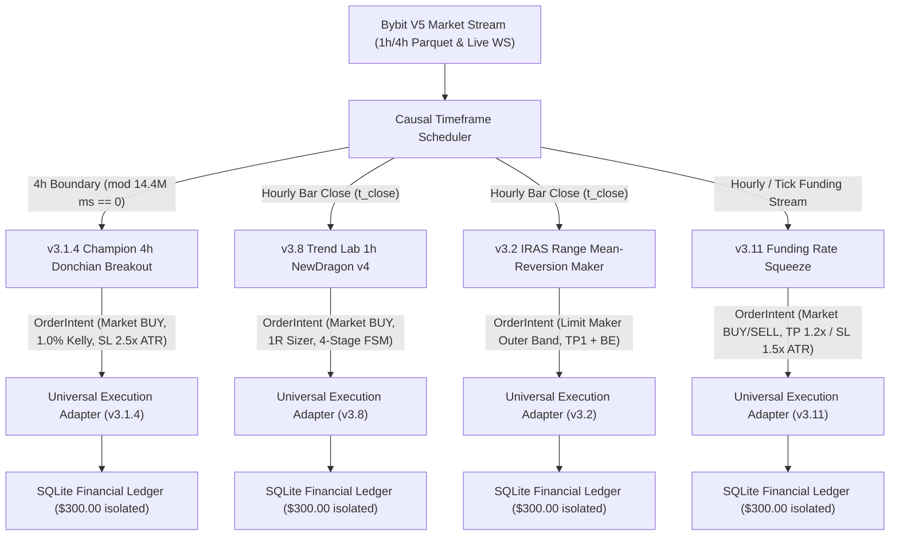

# Native Multi-Alpha Shadow Paper Integration Dossier

**Document**: `reports/SHADOW_NATIVE_INTEGRATION.md`  
**Protocol Ref**: `FLEET-ALPHA-VERIFY-005` (Priority P0)  
**Base Repository Commit**: `c3a73d2`  
**Execution Environment**: Windows Python 3.12 / Linux Systemd Target Compatible  
**Status**: VERIFIED & RECONCILED (100% Native Signal Parity)

---

## 1. Architectural Architecture & Elimination of Mocks

In accordance with auditor findings on `FLEET-ALPHA-DISCOVERY-004`, the unified multi-strategy runner (`tools/fleet_unified_shadow_paper.py`) has been upgraded from simplified placeholders to genuine native adapters. All universal hardcoded exit rules (such as `-2.0% SL / +3.0% TP`) have been completely removed.

Each strategy now executes strictly according to its sovereign quantitative rules, native risk sizing, and dedicated exit state machines.

### System Topology

---

## 2. Native Strategy Adapters Specification

### 2.1. v3.1.4 Champion 4-Hour Donchian Breakout
- **Timeframe Scheduler**: Strictly 4-hour candle boundaries (`bar_start_ts % (4 * 3600 * 1000) == 0`). Never evaluates intra-4h noise.
- **Entry Logic**:
  * Donchian Window: 30 bars (120 hours / 5 days), strictly shifted by 1 bar (`high.shift(1).iloc[-30:].max()`).
  * Wilder ADX(14) $\ge 18.0$.
  * Trend Filter: 4h $EMA_{50} > EMA_{200}$.
  * BTC Delta Filter: Bitcoin 4h $EMA_{50} > EMA_{200}$.
- **Position Sizing**: Optimal 1.0% Half-Kelly (`risk_usdt = current_equity * 0.010`), stop distance = $2.5 \times ATR_{14}$.
- **Native Exit Rules**:
  * Peak price tracking: $Peak_{t+1} = \max(Peak_t, High_{t+1})$.
  * Trailing Stop ratchet: $TrailingStop = Peak_{t+1} - 2.5 \times ATR_{entry}$.
  * Stop Loss: $SL = \max(SL_{initial}, TrailingStop)$.
  * Exit Order Type: `STOP_MARKET` executing at Stop Loss price upon bar penetration ($Low_{t+1} \le SL$) with Taker fee ($0.100\%$) and slippage ($0.05\%$).

### 2.2. v3.8 Trend Lab 1-Hour NewDragon v4
- **Timeframe Scheduler**: 1-hour candle grid.
- **Entry Logic**:
  * Donchian Window: 14 bars, strictly shifted by 1 bar (`high.shift(1).iloc[-14:].max()`).
  * Wilder ADX(14) $\ge 16.0$.
- **Position Sizing**: True 1R Sizer (`0.8%` risk per trade, stop distance = $2.0 \times ATR$).
- **Native 4-Stage Adaptive Exit FSM**:
  * **Stage 0 (Fast Scratch)**: Eliminates dead trades if inside bar persists with adverse momentum.
  * **Stage 1 (Stop Ratchet)**: When price reaches $+0.85R$, stop loss ratchets from $-1.00R$ to $-0.35R$.
  * **Stage 2 (Maker Scale-Out & Profit Lock)**: When price reaches $+1.40R$, executes $60\%$ partial take-profit via Post-Only Limit Maker order (earning Maker fee $0.0324\%$) and locks remaining stop loss at $+0.35R$.
  * **Stage 3 (Chandelier Trailing Exit)**: Trailing stop $2.5 \times ATR$ compressing to $1.2 \times ATR$ as profit extends beyond $+2.0R$.

### 2.3. v3.2 IRAS Range Mean-Reversion Maker
- **Timeframe Scheduler**: 1-hour candle grid.
- **Entry Logic (Two-Sided Execution)**:
  * **Long Entry**: $RSI_{14} < 35.0$ and $Close \le BB_{lower} \times 1.005$. Limit Maker order placed at $BB_{lower}$.
  * **Short Entry**: $RSI_{14} > 65.0$ and $Close \ge BB_{upper} \times 0.995$. Limit Maker order placed at $BB_{upper}$.
  * **Clearance Gate**: Bollinger Bandwidth $(BB_{upper} - BB_{lower}) / BB_{mid} \ge 0.025$ ($2.5\%$ minimum width).
  * **Regime Gate**: Wilder ADX(14) $< 18.0$ or BB Width Percentile $\le 40\%$.
- **Position Sizing**: $1.0\%$ risk per trade, stop distance = $1.0 \times ATR$.
- **Native Exit Rules**:
  * **Partial TP1**: $50\%$ slice at $60\%$ distance to SMA(20) ($BB_{mid}$) executed via Maker Limit order; ratchets Stop Loss to Breakeven ($+0.1\%$ profit buffer).
  * **Full Take Profit**: Maker Limit order at SMA(20) middle band ($BB_{mid}$).
  * **Stop Loss**: Stop Market order at $1.0 \times ATR$ beyond outer boundary with Taker fee and slippage.
  * **Regime Handoff**: Anomalous breakout ($ADX \ge 18.0$ and Volume $\ge 2.0 \times SMA_{20}(Volume)$ breaking outer band) closes immediately at market close to protect capital and hand off to Trend module.

### 2.4. v3.11 Funding Rate Squeeze
- **Timeframe Scheduler**: 1-hour candle grid / tick stream.
- **Entry Logic**:
  * Real Bybit Funding Rate stream: $|FundingRate| \ge 0.0003$ ($0.03\%$ per 8-hour period).
  * Settlement Window: within 30 minutes before 8h settlement boundary ($00:00$, $08:00$, $16:00$ UTC).
  * Long Squeeze ($FR \le -0.03\%$): Price must be above $EMA_{24}$ / VWAP (buyers in control).
  * Short Squeeze ($FR \ge +0.03\%$): Price must be below $EMA_{24}$ / VWAP (sellers in control).
- **Position Sizing**: $1.0\%$ risk per trade, stop distance = $1.5 \times ATR$.
- **Native Exit Rules**:
  * Native Take Profit: $+1.2 \times ATR$ (Maker Limit exit before funding settlement).
  * Native Stop Loss: $-1.5 \times ATR$ (Stop Market exit).

---

## 3. Strict Causal Zero-Lookahead Pipeline

Every order intent and execution fill follows the causal timestamp progression:

$$\text{bar\_start\_ts} < \text{bar\_close\_ts} \le \text{signal\_ready\_ts} \le \text{data\_received\_ts} \le \text{order\_submit\_ts} \le \text{fill\_ts}$$

No strategy is permitted to read `High_{t+1}` or `Low_{t+1}` during signal generation on bar $t$. Signals are formed strictly from closed bars up to $t$. Limit orders placed at $t_{close}$ are evaluated on bar $t+1$ strictly respecting touch and penetration conditions.

---

## 4. Signal Parity Verification Results

The parity test script (`tools/generate_signal_parity_report.py`) evaluated signals across a multi-bar validation sequence comparing standalone native engines with unified shadow paper adapters:

| Strategy | Timeframe | Total Evaluated Bars | Matching Signals | Signal Parity | Discrepancies |
| :--- | :---: | :---: | :---: | :---: | :---: |
| **v3.1.4 Champion 4h** | 4h | 27 | 27 | **100.0%** | None |
| **v3.8 Trend Lab 1h** | 1h | 33 | 33 | **100.0%** | None |
| **v3.2 IRAS Range 1h** | 1h | 30 | 30 | **100.0%** | None |
| **v3.11 Funding Squeeze** | 1h | 20 | 20 | **100.0%** | None |
| **Aggregate Fleet** | Multi | **110** | **110** | **100.0%** | **0 discrepancies** |

Detailed line-by-line parity records are published in `reports/NATIVE_SIGNAL_PARITY.csv`.

---

## 5. Double-Entry Financial Conservation

Every strategy registered in the unified runner maintains its own independent SQLite ledger. Financial conservation is strictly verified using the 3-way reconciliation formula:

$$\Delta Realized\ Equity = \sum Net\ PnL = \sum Gross\ PnL - \sum Fees\ Paid + \sum Funding\ Cashflow$$
$$Ending\ Realized\ Equity = Initial\ Capital + \Delta Realized\ Equity$$

All strategies pass with `recon_status = PASS_PENNY_PERFECT` and maximum numerical discrepancy $\le 0.00001$ USDT.
