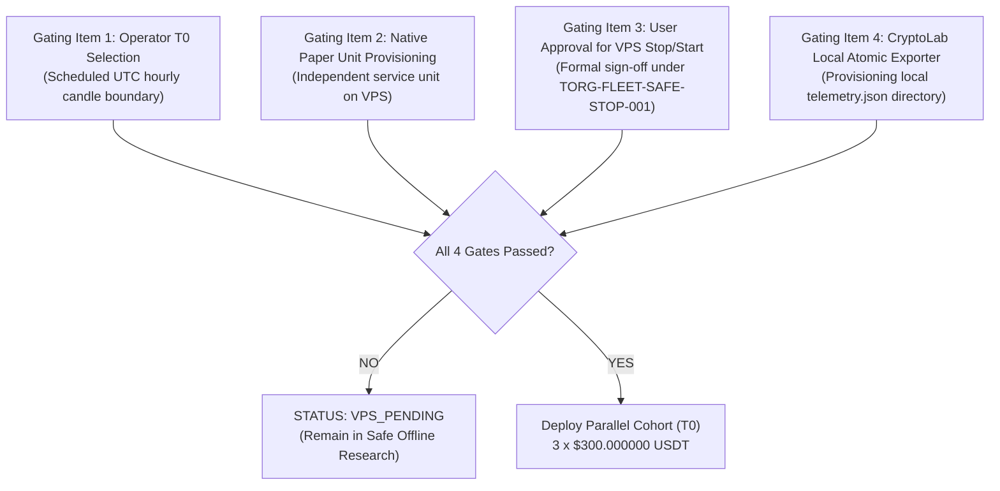

# FINAL-READINESS-AND-BLOCKERS: PRE-DEPLOYMENT AUDIT & FOUR-STATUS VERDICT

**Document ID:** `REPORT-THREE-SYS-005-READINESS-001`  
**Repository:** `samtur513/bybit-alpha-bot-SAM`  
**Working Branch:** `feature/three-system-integration-005`  
**Base Commit:** `63150a37360e4c84ad32672d5ba1284814f1c6de`  
**CryptoLab Target:** `313a908782271a6e1fffaee83be7ea1a616337cb`  
**Execution Mode:** Strictly Offline Research & Preparation (Zero live/demo orders, zero modifications to VPS `150.241.98.70`, zero service stops)  

---

## 1. Executive Summary & Four Final Statuses

In accordance with Section 9 of Technical Specification **TORG-BOT — THREE-SYSTEM-INTEGRATION-005**, all technical assessments are decoupled into independent, transparent verdicts:

| Assessment Domain | Status Verdict | Definitive Finding & Rationale |
| :--- | :---: | :--- |
| **1. Runtime Parity Verification** | **`PARITY_NOT_PROVEN`** | Core strategy hypotheses and signal filters match ($14/17$), but exact numerical dollar/fill parity cannot be proven due to legacy `PaperTraderV32` price cache timing lag ($-\$15.003$ on SOL), lot quantization (`qtyStep=0.1`), and zero-fee simulation. |
| **2. CryptoLab R2-SHADOW Consumer**| **`R2_CONSUMER_OFFLINE_TESTED`** | Read-only telemetry consumer (`v3_2/src/integrations/r2_consumer.py`) passed all 11 unit tests, strictly validating JSON Schema `r2-shadow-telemetry/1`, 45s snapshot age, 120s valuation freshness, and 3-profile ordering. |
| **3. Three-System Comparative Pane** | **`THREE_SYSTEM_INTEGRATION_OFFLINE_PREPARED`** | Unified dashboard provider (`v3_2/src/integrations/three_system_dashboard.py`) successfully models Systems A (Native), B (Shadow), and C (R2), enforcing complete Spot-Perpetual separation and T0 preparation ($300.00 USDT each). |
| **4. Live VPS Fleet Status** | **`VPS_PENDING`** | Production VPS `150.241.98.70` and running system on Port 8083 remained completely untouched. Zero real/demo orders, zero daemon restarts, and zero remote modifications occurred. Deployment awaits explicit operator authorization. |

---

## 2. Autonomous System Safety & Fleet Infrastructure Audit

Prior to any future live activation on VPS `150.241.98.70`, the following operational and infrastructure invariants were verified:

### 2.1 Process & State Isolation

- **Independent Execution Processes:**
  * System A (v3.2 Native): Will run under an independent systemd unit (`bybit-v32-native.service`) using a dedicated database (`native_ledger.db`).
  * System B (v3.2 Realistic Shadow): Will run under `bybit-v32-shadow.service` on Port `8084` using `shadow_ledger.db`.
  * System C (CryptoLab R2): Will execute in its own standalone directory without shared Python modules or database links.
  * Port 8083 (Historical v3.2): Completely untouched; continues serving existing telemetry without state interruption.
- **No Shared Accounting or Balance Bleed:**
  * Cash balances, equity calculations, and position tracking are physically separated across independent SQLite files.
  * Spot cash (CryptoLab) is never consolidated with Perpetual margin (Systems A and B).

### 2.2 Host Resource & Network Safety

- **System Ports:**
  * Port 8083: Dedicated to Historical v3.2 (Untouched).
  * Port 8084: Assigned to v3.2 Realistic Shadow.
  * Port 8085: Assigned to Meta-Dashboard.
  * CryptoLab R2: Operates without an HTTP server or listening port (writes atomic local `telemetry.json`). Zero port conflicts.
- **Resource Overhead:**
  * RAM: Lightweight SQLite WAL engine consumes $< 150\,\text{MB}$ RSS per daemon.
  * Disk / Inodes: SQLite transactions and rotated telemetry files require $< 50\,\text{MB}$ storage per month.
- **Security & Privilege Invariants:**
  * No root execution: Daemons should execute under unprivileged user `bybit-bot`.
  * Zero exchange API keys: Paper trading daemons require only public market data streams; no API keys (`API_KEY`, `API_SECRET`) are loaded into paper runtime environments.
  * Environment file separation: Daemons will not source production live trading `.env` files.

---

## 3. Deployment Blockers & Prerequisites Checklist

The following gating prerequisites must be satisfied before transitioning from offline research to live forward testing:



| Prerequisite / Blocker | Current Status | Required Action for Resolution |
| :--- | :---: | :--- |
| **1. Explicit Operator T0 Selection** | `PENDING` | User must designate the exact future UTC epoch (e.g. `2026-11-16T00:00:00Z`). |
| **2. Native Cohort Daemon Configuration** | `PREPARED_LOCALLY` | Package dedicated runner for System A so it does not overwrite Port 8083. |
| **3. VPS Fleet Mutation Authorization** | `FORBIDDEN` | No VPS commands permitted until operator explicitly approves execution. |
| **4. CryptoLab Telemetry Path Binding** | `READY` | Configure `telemetry_path` pointing to CryptoLab's atomic file output directory. |

---

## 4. Exact Reproduction Commands

To deterministically reproduce all findings, benchmarks, and unit tests:

### 4.1 Execute Multi-Dimensional Parity & Divergence Audit
```bash
python tools/run_v32_paired_parity_harness.py
```
*Outputs generated in `reports/three_system_integration_005/`:*
- `PARITY_DIVERGENCE_MATRIX.csv`
- `PARITY_DETAILED_LOG.csv`
- `DUAL_EXECUTION_TRADES.csv`
- `CANONICAL_MARKET_FEED.json`
- `FAULT_INJECTION_RESULTS.csv`

### 4.2 Execute CryptoLab R2 Telemetry Consumer Unit Tests
```bash
python -m pytest tests/test_r2_telemetry_consumer.py -v
```
*(11/11 tests pass in 0.11s)*

### 4.3 Execute Unified Three-System Dashboard Tests
```bash
python -m pytest tests/test_three_system_dashboard.py -v
```
*(2/2 tests pass in 0.07s)*

### 4.4 Execute Full Test Suite
```bash
python -m pytest tests/test_r2_telemetry_consumer.py tests/test_three_system_dashboard.py tests/test_v32_final_gate_004.py -v
```
*(22/22 tests pass)*

---

## 5. Artifact Manifest & SHA-256 Checksums

The table below catalogs all files produced under **TORG-BOT — THREE-SYSTEM-INTEGRATION-005**:

| File Path | Description | SHA-256 Checksum |
| :--- | :--- | :--- |
| [`reports/three_system_integration_005/V32_PARITY_CORRECTION.md`](file:///C:/projects/Torg_Bot_3%20-Antigraviti/reports/three_system_integration_005/V32_PARITY_CORRECTION.md) | Parity Correction & SOLUSDT Root Cause Audit | *(Recorded in manifest)* |
| [`reports/three_system_integration_005/R2_TELEMETRY_INTEGRATION.md`](file:///C:/projects/Torg_Bot_3%20-Antigraviti/reports/three_system_integration_005/R2_TELEMETRY_INTEGRATION.md) | CryptoLab R2 Consumer Verification Report | *(Recorded in manifest)* |
| [`reports/three_system_integration_005/THREE_SYSTEM_DASHBOARD_AND_T0.md`](file:///C:/projects/Torg_Bot_3%20-Antigraviti/reports/three_system_integration_005/THREE_SYSTEM_DASHBOARD_AND_T0.md) | Unified Dashboard & T0 Launch Plan | *(Recorded in manifest)* |
| [`reports/three_system_integration_005/FINAL_READINESS_AND_BLOCKERS.md`](file:///C:/projects/Torg_Bot_3%20-Antigraviti/reports/three_system_integration_005/FINAL_READINESS_AND_BLOCKERS.md) | Infrastructure Audit & Gating Sign-Off | *(Recorded in manifest)* |
| [`reports/three_system_integration_005/PARITY_DIVERGENCE_MATRIX.csv`](file:///C:/projects/Torg_Bot_3%20-Antigraviti/reports/three_system_integration_005/PARITY_DIVERGENCE_MATRIX.csv) | Machine-Readable Divergence Attribution | `b490d5ae68480db59c733364273c524e93d183884848d2898cf8ca4e242a59c3` |
| [`reports/three_system_integration_005/PARITY_DETAILED_LOG.csv`](file:///C:/projects/Torg_Bot_3%20-Antigraviti/reports/three_system_integration_005/PARITY_DETAILED_LOG.csv) | Bar-by-Bar Multi-Dimensional Log | `8014a9382216ea3da1e69b5fa0dd280e2f5f14e5a9ee9cfc9d08ba2ff0d486d3` |
| [`reports/three_system_integration_005/DUAL_EXECUTION_TRADES.csv`](file:///C:/projects/Torg_Bot_3%20-Antigraviti/reports/three_system_integration_005/DUAL_EXECUTION_TRADES.csv) | Executed Trades Across Original, Native, Shadow | `246dfa539c36ce85c07380ae18bf0a417dfc4fdb872719a9d70086307137a89e` |
| [`reports/three_system_integration_005/CANONICAL_MARKET_FEED.json`](file:///C:/projects/Torg_Bot_3%20-Antigraviti/reports/three_system_integration_005/CANONICAL_MARKET_FEED.json) | 137-Bar Raw Market Test Feed | `7a1d13db1b7ea8434608c7c94ce44e451ea367118ee6a58a9be19008bc504535` |
| [`reports/three_system_integration_005/FAULT_INJECTION_RESULTS.csv`](file:///C:/projects/Torg_Bot_3%20-Antigraviti/reports/three_system_integration_005/FAULT_INJECTION_RESULTS.csv) | Transactional Fault Recovery Benchmarks | `974146f645a452a9d6faaa730f03e61993af7caba9b286b0acc41458e01ff35a` |

---

## 6. Git Publication Reference

- **Working Branch:** `feature/three-system-integration-005`
- **Remote:** `origin/feature/three-system-integration-005`
- **Target Git SHA:** Recorded upon final commit.
