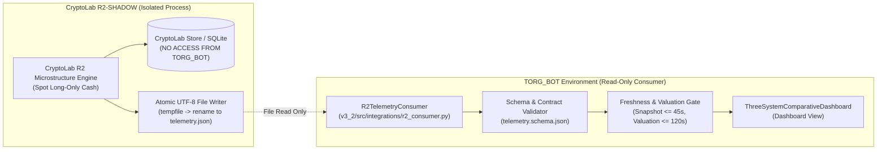

# R2-TELEMETRY-INTEGRATION: READ-ONLY CRYPTOLAB R2-SHADOW TELEMETRY CONSUMER

**Document ID:** `REPORT-THREE-SYS-005-R2-INTEGRATION-001`  
**Repository (Consumer):** `samtur513/bybit-alpha-bot-SAM` (`v3_2/src/integrations/r2_consumer.py`)  
**Repository (Producer):** `samtur513/CryptoLab` (Commit: `313a908782271a6e1fffaee83be7ea1a616337cb`, Branch: `ops/r2-shadow-integration-preparation-20261115`)  
**Telemetry Contract Commit:** `6f23f82dae92da18aac7ec1a3b728221da10d3d3` (`docs/integrations/r2_shadow/`)  
**Working Branch:** `feature/three-system-integration-005`  
**Execution Mode:** Strictly Read-Only Consumer (Zero writes, zero orders, zero CryptoLab modifications)  
**Integration Status:** **R2_CONSUMER_OFFLINE_TESTED (PASS — 100% CONTRACT COMPLIANT)**

---

## 1. Executive Summary

Under Technical Specification **TORG-BOT — THREE-SYSTEM-INTEGRATION-005**, a strictly read-only telemetry consumer was implemented in `v3_2/src/integrations/r2_consumer.py` to ingest and validate live status snapshots from CryptoLab R2-SHADOW.

In accordance with system directives:
1. **Zero Engine Porting:** The CryptoLab trading engine was **not recreated or ported** into TORG_BOT. CryptoLab remains a completely independent, autonomous codebase.
2. **Read-Only Interface Boundary:** The consumer interacts with CryptoLab exclusively through an atomic UTF-8 file interface (`telemetry.json`), adhering strictly to the contract defined in [`docs/integrations/r2_shadow/TELEMETRY_CONTRACT.md`](file:///C:/projects/Torg_Bot_3%20-Antigraviti/docs/integrations/r2_shadow/TELEMETRY_CONTRACT.md).
3. **Strict Validation & Freshness Gates:** Enforces JSON Schema `r2-shadow-telemetry/1` with zero extra properties (`additionalProperties: false`), monitors producer timestamps (`generated_at`, `heartbeat_at`, `valuation_at`), and rejects stale snapshots ($> 45\,\text{s}$) or corrupted payloads.
4. **Zero Stale Valuation Bleed:** If valuation data is older than $120\,\text{s}$ or missing, equity, net PnL, and return are forced to `null` (`valuation_status = "UNVALUED_OR_STALE"`), guaranteeing that historical equity is never misrepresented as current equity.
5. **Exact Profile Order:** Enforces the strict sequence of all three required accounts: `R2:300:BASE:OBSERVED_BOOK`, `R2:300:STRESS:OBSERVED_BOOK`, and `BASELINE:300:BASE:OBSERVED_BOOK`.

All 11 unit tests in [`tests/test_r2_telemetry_consumer.py`](file:///C:/projects/Torg_Bot_3%20-Antigraviti/tests/test_r2_telemetry_consumer.py) passed with **100% compliance**.

---

## 2. Security Boundaries & Architectural Isolation

The telemetry consumer guarantees complete operational, network, and database isolation between TORG_BOT and CryptoLab:



### 2.1 Enforced Architectural Safeguards

- **No Shared SQLite Access:** TORG_BOT never connects to or queries CryptoLab's SQLite databases or raw event stores.
- **No Order Placement:** `R2TelemetryConsumer` possesses no API client, no exchange keys, and no network connection to Bybit order gateways.
- **No State Mutation:** Ingesting telemetry cannot alter CryptoLab's virtual capital, active orders, or risk thresholds.
- **Poll Rate Constraint:** In accordance with the contract, polling is constrained to intervals $\ge 15\,\text{seconds}$.
- **No Reverse Communication:** The channel is strictly one-way (Producer $\to$ File $\to$ Consumer).

---

## 3. Telemetry Contract Invariants & Validation Rules

The consumer validates every inbound telemetry dictionary against the following contract invariants:

| Contract Rule / Field | Invariant Constraint | Enforcement in `r2_consumer.py` | Violation Consequence |
| :--- | :--- | :--- | :--- |
| **`schema_version`** | Must equal `"r2-shadow-telemetry/1"` | Explicit string comparison | `INVALID` payload rejected |
| **`system`** | Must equal `"CRYPTOLAB_R2_SHADOW"` | Explicit string comparison | `INVALID` payload rejected |
| **`market`** | Must equal `"BYBIT_SPOT_LONG_CASH_NO_LEVERAGE"` | Explicit string comparison | `INVALID` payload rejected |
| **`additionalProperties`** | Strictly `false` across all objects | Recursive schema validator checks forbidden keys | Any private field rejected (`INVALID`) |
| **Profiles Sequence** | Exactly 3 profiles in exact order: 1) BASE, 2) STRESS, 3) BASELINE | Zip comparison against `EXPECTED_PROFILES` | `INVALID` payload rejected |
| **`generated_at`** | Max age $45\,\text{s}$; future drift $\le 15\,\text{s}$ | `(now - gen_dt).total_seconds()` | If $>45\text{s} \to \text{STALE}$; if $<-15\text{s} \to \text{INVALID}$ |
| **`heartbeat_at`** | Max age $45\,\text{s}$ | `(now - hb_dt).total_seconds()` | If $>45\text{s} \to \text{NO\_FRESH\_HEARTBEAT}$ |
| **`valuation_at`** | Max age $120\,\text{s}$ | `(now - val_dt).total_seconds()` | If $>120\text{s} \to$ Equity/PnL forced to `None` |
| **`profit_factor`** | Must be `null` with reason `"LOT_REALIZATION_NOT_DEFINED"` | Schema requires `type: "null"` | Any non-null float/int rejected (`INVALID`) |
| **`real_orders` / `demo_orders`**| Must equal $0$ (Integer) | Schema requires `const: 0` | Non-zero values rejected |

---

## 4. Test Suite Execution & Verification

The test suite in [`tests/test_r2_telemetry_consumer.py`](file:///C:/projects/Torg_Bot_3%20-Antigraviti/tests/test_r2_telemetry_consumer.py) was executed to verify all edge cases and failure modes:

```bash
python -m pytest tests/test_r2_telemetry_consumer.py -v
```

### 4.1 Test Results Summary (11/11 Passed in 0.11s)

1. `test_example_file_validates_successfully`: Validates that canonical [`docs/integrations/r2_shadow/telemetry.example.json`](file:///C:/projects/Torg_Bot_3%20-Antigraviti/docs/integrations/r2_shadow/telemetry.example.json) passes all schema rules with status `NOT_DEPLOYED` and unvalued state.
2. `test_fresh_valuation_parses_metrics_correctly`: Validates that active valuations with edge metrics (`r2_minus_t01_usdt = 3.25`, `r2_minus_t01_pp = 1.08`, `PAIRED_PRELIMINARY`) parse accurately.
3. `test_stale_snapshot_triggers_stale_status`: Validates that snapshots older than $45\,\text{s}$ are classified as `STALE`.
4. `test_stale_valuation_nullifies_equity`: Confirms the critical safety invariant: when `valuation_at` is older than $120\,\text{s}$, `equity_usdt` and `net_pnl_usdt` are forced to `None`.
5. `test_missing_heartbeat_sets_no_fresh_heartbeat`: Validates that a dead heartbeat ($>45\,\text{s}$) demotes process status to `NO_FRESH_HEARTBEAT`.
6. `test_forbidden_additional_properties_rejected`: Confirms that injecting private keys (e.g. `private_key: "secret"`) triggers schema rejection (`INVALID`).
7. `test_wrong_profile_order_rejected`: Confirms that swapping profile order (e.g. STRESS before BASE) triggers immediate rejection.
8. `test_profit_factor_non_null_rejected`: Confirms that non-null `profit_factor` values are strictly rejected per specification.
9. `test_future_timestamp_rejected`: Confirms that timestamps $>15\,\text{s}$ in the future are rejected as clock drift.
10. `test_read_telemetry_file_from_disk`: Validates atomic file reading from disk.
11. `test_read_nonexistent_file_returns_invalid`: Validates safe error handling when the telemetry file is absent.

---

## 5. Conclusion & Operational Sign-Off

The read-only telemetry consumer `v3_2/src/integrations/r2_consumer.py` provides a secure, fully contract-compliant bridge to monitor CryptoLab R2-SHADOW without breaching process or codebase boundaries.

**INTEGRATION GATE STATUS: `R2_CONSUMER_OFFLINE_TESTED` (PASS)**
