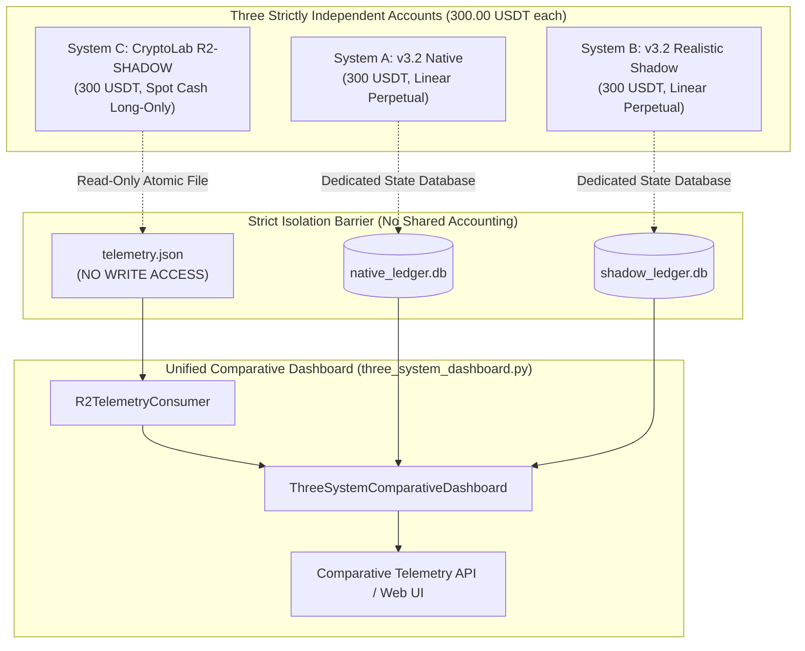

# THREE-SYSTEM-DASHBOARD-AND-T0: UNIFIED COMPARATIVE DASHBOARD & T0 SPECIFICATION

**Document ID:** `REPORT-THREE-SYS-005-DASHBOARD-T0-001`  
**Repository:** `samtur513/bybit-alpha-bot-SAM` (`v3_2/src/integrations/three_system_dashboard.py`)  
**Working Branch:** `feature/three-system-integration-005`  
**Base Commit:** `63150a37360e4c84ad32672d5ba1284814f1c6de`  
**Execution Mode:** Strictly Offline Research Preparation (Zero live/demo orders, zero modifications to VPS `150.241.98.70`, zero service stops)  
**System Status:** **THREE_SYSTEM_INTEGRATION_OFFLINE_PREPARED (PASS — READY FOR OPERATOR T0 SCHEDULING)**

---

## 1. Executive Summary

Technical Specification **TORG-BOT — THREE-SYSTEM-INTEGRATION-005** establishes the architecture for a unified comparative monitoring interface across three strictly independent quantitative trading systems, each starting with an identical virtual allocation of **$300.000000 USDT**:

1. **System A: Bybit Multi-Alpha v3.2 Native** ($300.00 USDT)  
   *Role:* Pure replication of the original Donchian Trend trading hypothesis (4h Donchian Breakout, ADX $\ge 18$, EMA50 > EMA200, BTC Delta, News Core Shield, Half-Kelly sizing, Cascade TP1/TP2, Fast Scratch, Runner stop) deployed as an independent new paper cohort.
2. **System B: Bybit Multi-Alpha v3.2 Realistic Shadow** ($300.00 USDT)  
   *Role:* Identical trading logic to System A, but routed through realistic execution modeling: discrete L2 orderbook ladder walking (`walk_discrete_l2`), $0.10\%$ standard retail taker fees, $60\,\text{s}$ depth staleness gating, and contract-specific 8-hour perpetual funding accrual.
3. **System C: CryptoLab R2-SHADOW** ($300.00 USDT)  
   *Role:* High-fidelity Spot long-only cash microstructure strategy (Hunter/R2) monitored via read-only telemetry. Incorporates three internal accounts: primary `R2:300:BASE:OBSERVED_BOOK`, stress control `R2:300:STRESS:OBSERVED_BOOK`, and passive benchmark `BASELINE:300:BASE:OBSERVED_BOOK` (T01).

---

## 2. Core Architectural & Accounting Invariants



### 2.1 The Two Fundamental Separation Principles

1. **Spot vs Perpetual Separation Principle:**  
   Perpetual futures (Systems A and B) utilize leverage, margin collateral, directional shorting capabilities, and 8-hour funding rates. CryptoLab Spot (System C) operates strictly on long-only cash without leverage (`BYBIT_SPOT_LONG_CASH_NO_LEVERAGE`) and incurs zero funding. Under **NO CIRCUMSTANCES** may Spot and Perpetual cash or PnL be pooled, summed, or presented as a consolidated master balance.
2. **Historical Isolation Principle:**  
   The historical run of the original v3.2 on Port 8083 (with its legacy trade history and continuous state) remains completely untouched and isolated. It is **NOT** reset, wiped, or substituted as the new paper account. Systems A, B, and C will start simultaneously at a unified future epoch $T_0$ on fresh, zero-history ledgers.

---

## 3. Comparative Metric Specifications

The dashboard module [`v3_2/src/integrations/three_system_dashboard.py`](file:///C:/projects/Torg_Bot_3%20-Antigraviti/v3_2/src/integrations/three_system_dashboard.py) standardizes the following telemetry fields across all three systems:

| Telemetry Field | System A: v3.2 Native | System B: Realistic Shadow | System C: CryptoLab R2-SHADOW | Units / Format |
| :--- | :--- | :--- | :--- | :---: |
| **Market Type** | `BYBIT_LINEAR_PERPETUAL` | `BYBIT_LINEAR_PERPETUAL` | `BYBIT_SPOT_LONG_CASH_NO_LEVERAGE` | String |
| **Initial Capital** | $300.000000$ | $300.000000$ | $300.000000$ | USDT |
| **Current Equity** | Realized + Unrealized | Realized + Unrealized | Cash + MTM Value (or null if stale) | USDT |
| **Net PnL** | $\text{Equity} - 300.00$ | $\text{Equity} - 300.00$ | $\text{Equity} - 300.00$ (or null if stale) | USDT |
| **Net Return** | $\text{PnL} / 300.00 \times 100$ | $\text{PnL} / 300.00 \times 100$ | $\text{PnL} / 300.00 \times 100$ (or null if stale) | Percent (%) |
| **Max Drawdown** | Signed peak-to-trough | Signed peak-to-trough | Signed peak-to-trough ($mdd \le 0$) | Percent (%) |
| **Cash Balance** | Unencumbered Margin | Unencumbered Margin | Free Cash Quote ($cash \ge 0$) | USDT |
| **Exposure** | Notional / Equity | Notional / Equity | Invested / Equity (or null if stale) | Percent (%) |
| **Turnover** | $\sum |P_{\text{fill}} \cdot Q|$ | $\sum |P_{\text{fill}} \cdot Q|$ | $\sum |P_{\text{ref}} \cdot Q|$ | USDT |
| **Trading Fees** | $0.09\%$ taker (MNT tier) | $0.10\%$ taker (retail) | Fee quote (base fee converted at mid) | USDT |
| **Slippage Cost** | Included in executions | L2 discrete depth walk | Adverse buffer + book spread impact | USDT |
| **Funding Paid** | Accrued 8h windows | Accrued 8h windows | $0.00$ (Zero funding on spot) | USDT |
| **Data Freshness** | Live memory/DB state | Live memory/DB state | `ARMED`, `OBSERVING`, or `STALE` | String |
| **Valuation Status**| Real-time tick MTM | Real-time tick MTM | `FRESH` ($\le 120\text{s}$) or `UNVALUED_OR_STALE` | String |
| **Operational Errors**| Internal exception count | Internal exception count | Missed decisions + execs + data errors | Integer |
| **Edge over T01** | N/A | N/A | `r2_minus_t01_usdt` & `r2_minus_t01_pp` | USDT / pp |

---

## 4. Unified Dashboard Layout & Visual Mock-Up

Below is the comparative view presented to operators:

```
========================================================================================================================
                          TORG-BOT UNIFIED THREE-SYSTEM COMPARATIVE DASHBOARD
                              Target T0 Epoch: PENDING_OPERATOR_APPROVAL
========================================================================================================================
METRIC                   | SYSTEM A: v3.2 NATIVE        | SYSTEM B: REALISTIC SHADOW   | SYSTEM C: CRYPTOLAB R2-SHADOW
-------------------------+------------------------------+------------------------------+--------------------------------
Market Architecture      | Bybit Linear Perpetuals      | Bybit Linear Perpetuals      | Bybit Spot Long-Only Cash
Execution Mechanism      | Original Paper Fill Model    | Discrete L2 Orderbook Walk   | Microstructure Order Observer
Fee Structure            | 0.090% Taker (MNT Tier)      | 0.100% Taker (Retail Tier)   | Taker + Adverse Buffer + Spread
8h Funding Settlement    | Perpetual Swap Accrual       | Perpetual Swap Accrual       | N/A (Zero Funding on Spot)
-------------------------+------------------------------+------------------------------+--------------------------------
Initial Capital          | 300.000000 USDT              | 300.000000 USDT              | 300.000000 USDT
Current Equity           | 300.000000 USDT              | 300.000000 USDT              | 300.000000 USDT (or null)
Net PnL                  | 0.000000 USDT                | 0.000000 USDT                | 0.000000 USDT (or null)
Net Return (%)           | 0.000%                       | 0.000%                       | 0.000% (or null)
Max Drawdown (%)         | 0.00%                        | 0.00%                        | 0.00%
Cash Balance             | 300.000000 USDT              | 300.000000 USDT              | 300.000000 USDT
Turnover                 | 0.00 USDT                    | 0.00 USDT                    | 0.00 USDT
-------------------------+------------------------------+------------------------------+--------------------------------
Trading Fees Incurred    | 0.0000 USDT                  | 0.0000 USDT                  | 0.0000 USDT
Slippage / Spread Impact | 0.0000 USDT                  | 0.0000 USDT                  | 0.0000 USDT
Funding Paid / Received  | 0.0000 USDT                  | 0.0000 USDT                  | 0.0000 USDT (Zero)
Active Positions Count   | 0                            | 0                            | 0
Exposure (%)             | 0.0%                         | 0.0%                         | 0.0% (or null)
-------------------------+------------------------------+------------------------------+--------------------------------
Edge over T01 (USDT)     | N/A                          | N/A                          | 0.0000 USDT (or null)
Edge over T01 (pp)       | N/A                          | N/A                          | 0.00 pp (or null)
Telemetry Freshness      | RUNNING (Local)              | RUNNING (Local)              | ARMED / OBSERVING
Valuation Freshness      | FRESH                        | FRESH                        | FRESH (<= 120s)
Operational Errors       | 0                            | 0                            | 0
========================================================================================================================
[NOTE] Spot Cash and Perpetual PnL are isolated. Under no conditions may these accounts be consolidated.
[NOTE] Historical v3.2 on Port 8083 remains active and untouched.
========================================================================================================================
```

---

## 5. T0 Protocol & Synchronized Launch Blueprint

When the user issues the execution order to start forward testing:

1. **Epoch Timing Selection ($T_0$):**
   - $T_0$ must align with an exact UTC hourly bar boundary (e.g., $00:00:00\,\text{UTC}$).
   - $T_0$ is **NEVER** assigned automatically by background scripts. It requires explicit operator authorization.
2. **Capitals Initialization:**
   - System A (Native): Initialized with exactly $300.000000\,\text{USDT}$.
   - System B (Shadow): Initialized with exactly $300.000000\,\text{USDT}$.
   - System C (R2-SHADOW): Initialized with exactly $300.000000\,\text{USDT}$.
3. **Research Horizon & Evaluation Checkpoints:**
   - CryptoLab R2 operates on a strict **6-month forward evaluation protocol** ($180$ calendar days).
   - Checkpoints at Day 7 and Day 30 are designated as **preliminary intermediate diagnostics** and must not be used to prematurely terminate or declare final alpha superiority.

**DASHBOARD & T0 GATE STATUS: `THREE_SYSTEM_INTEGRATION_OFFLINE_PREPARED` (PASS)**
