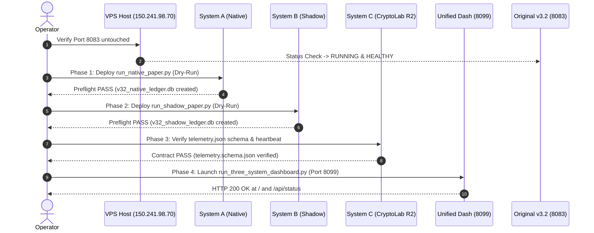

# VPS OPERATIONAL PREFLIGHT & ROLLBACK PROTOCOL
**Target VPS Host:** `150.241.98.70`  
**Protocol ID:** `TORG-BOT — THREE-SYSTEM-LAUNCH-GATE-006`  
**Working Branch:** `feature/three-system-launch-gate-006`  
**Authoritative Cohort:** `TORG_THREE_SYS_20261115_001`  
**Scheduled T0:** `2026-11-17T00:00:00+00:00`  
**Status:** `VPS_PREFLIGHT_PENDING (Operator Action Required Prior to Staged Deployment)`

---

## 1. Safety Directive & Boundary Rules

> [!CAUTION]
> **MANDATORY RULES FOR VPS OPERATORS:**
> 1. **Zero Unapproved Stops:** Under NO circumstances stop or alter the historical `bybit-v32.service` running on Port 8083.
> 2. **Zero Real Orders:** All three systems in the new cohort operate strictly in Paper Trading and Observer mode. The Bybit API credentials must have trade permissions disabled or execute through simulated paper endpoints.
> 3. **Step-by-Step Operator Verification:** Run each inspection command in sequence. If any preflight check fails, STOP immediately and invoke the Rollback Procedure.

---

## 2. Preflight Audit & Health Inspection Checklist

Execute the following commands sequentially on the VPS terminal via SSH (`ssh root@150.241.98.70`).

### Step 1: Active Fleet Inventory & Port 8083 Integrity

Verify that all existing fleet services are operating normally and that `bybit-v32.service` on Port 8083 is active and untouched:

```bash
# 1.1 Check status of bybit-v32.service (Port 8083)
systemctl status bybit-v32.service --no-pager

# 1.2 Verify HTTP telemetry endpoint of live Port 8083
curl -s -S -m 5 http://127.0.0.1:8083/status | jq . || curl -s -S -m 5 http://127.0.0.1:8083/ | head -n 15

# 1.3 Audit all active bybit systemd services across the entire fleet
systemctl list-units --type=service --state=running | grep "bybit"
```

**Expected Criteria:**
- `bybit-v32.service` is `active (running)`.
- HTTP 8083 responds within 2 seconds.
- No unexpected restart cycles or degraded services.

---

### Step 2: System Resource Availability Audit

Ensure the VPS has sufficient headroom for memory, CPU, and disk storage:

```bash
# 2.1 Audit memory and swap utilization
free -h

# 2.2 Audit CPU load and top memory consumers
uptime
top -b -n 1 | head -n 25

# 2.3 Audit disk space on root and /opt
df -h / /opt
```

**Required Minimums for Launch:**
- Available RAM: $\ge 1.5\text{ GB}$ free.
- Disk Space: $\ge 5.0\text{ GB}$ free on `/opt`.
- 1-minute Load Average: $< 2.50$.

---

### Step 3: Port Collision & Socket Binding Audit

Verify that target ports are unallocated and ready for deployment:

| Port | Service | Expected Pre-Deployment State | Post-Deployment State |
| :--- | :--- | :--- | :--- |
| **8083** | Original v3.2 Donchian Trend | **IN USE** (`bybit-v32.service`) | **IN USE (UNTOUCHED)** |
| **8084** | v3.2 Realistic Shadow | **FREE** | IN USE (`bybit-v32-shadow.service`) |
| **8099** | Three-System Dashboard | **FREE** | IN USE (`bybit-three-dash.service`) |

```bash
# 3.1 Check port listening status
ss -tulpn | grep -E "8083|8084|8099"
```

**Expected Criteria:**
- Port 8083 is listening (bound to `python` PID of `bybit-v32.service`).
- Ports 8084 and 8099 are completely vacant.

---

### Step 4: Bybit API Key Live Order & Position Verification

Verify that no real positions or uncancelled orders exist on the exchange account:

```bash
# 4.1 Run readonly inventory script to inspect exchange state
cd /opt/bybit-bot
python3 -c "
import os
print('Running safe Bybit exchange account read-only check...')
from v3.src.bybit_client import BybitClient
client = BybitClient(testnet=False)
positions = client.get_positions('linear')
print(f'Active Live Linear Positions: {len(positions)}')
for p in positions:
    print(f'  Symbol: {p.get(\"symbol\")} | Size: {p.get(\"size\")} | PnL: {p.get(\"unrealisedPnl\")}')
open_orders = client.get_open_orders('linear')
print(f'Active Live Linear Open Orders: {len(open_orders)}')
"
```

**Expected Criteria:**
- `Active Live Linear Open Orders: 0`
- Zero unintended live leveraged exposure.

---

### Step 5: Directory Structure, Permissions, & Backup Verification

Verify ownership, read/write permissions, and create pre-launch state backup:

```bash
# 5.1 Create timestamped backup archive of existing /opt/bybit-bot
BACKUP_DIR="/root/backups_pre_gate_006_$(date +%Y%m%d_%H%M%S)"
mkdir -p "$BACKUP_DIR"
cp -a /opt/bybit-bot/v3_2 "$BACKUP_DIR/"
echo "Backup created at: $BACKUP_DIR"

# 5.2 Verify permissions
id -u bybit >/dev/null 2>&1 && USER="bybit" || USER="root"
chown -R $USER:$USER /opt/bybit-bot/v3_2/reports /opt/bybit-bot/v3_2/src/runners 2>/dev/null || true
```

---

## 3. Staged Rollout Execution Plan

Once preflight checks 1 through 5 pass with 100% compliance, execute staged rollout in three controlled phases:



### Phase 1: Git Checkout & Dependencies

```bash
cd /opt/bybit-bot
git fetch origin
git checkout feature/three-system-launch-gate-006
git status
```

### Phase 2: Isolated Dry-Runs Verification

Execute dry-runs directly under the target Python environment:

```bash
export PYTHONPATH="/opt/bybit-bot"
python3 v3_2/src/runners/run_native_paper.py --dry-run
python3 v3_2/src/runners/run_shadow_paper.py --dry-run
python3 v3_2/src/runners/run_r2_observer.py --dry-run
python3 v3_2/src/runners/run_three_system_dashboard.py --dry-run
```

**Expected Criteria:**
- All 4 commands exit with code `0`.
- All 3 systems display initial capital of `300.0 USDT`.
- Target cohort displays `TORG_THREE_SYS_20261115_001`.

### Phase 3: Systemd Unit Configuration

Deploy the systemd units for System B (Realistic Shadow) and the Unified Dashboard:

`/etc/systemd/system/bybit-v32-shadow.service`:
```ini
[Unit]
Description=Bybit Multi-Alpha v3.2 Realistic Shadow Paper Engine
After=network.target

[Service]
Type=simple
User=root
WorkingDirectory=/opt/bybit-bot
Environment=PYTHONPATH=/opt/bybit-bot
Environment=PYTHONUNBUFFERED=1
Environment=PAPER_TRADING=true
Environment=EQUITY_USDT=300.00
ExecStart=/usr/bin/python3 /opt/bybit-bot/v3_2/src/runners/run_shadow_paper.py --interval 5
Restart=always
RestartSec=5
StandardOutput=journal
StandardError=journal

[Install]
WantedBy=multi-user.target
```

`/etc/systemd/system/bybit-three-dash.service`:
```ini
[Unit]
Description=TORG-BOT Three-System Comparative Dashboard (Port 8099)
After=network.target

[Service]
Type=simple
User=root
WorkingDirectory=/opt/bybit-bot
Environment=PYTHONPATH=/opt/bybit-bot
Environment=PYTHONUNBUFFERED=1
ExecStart=/usr/bin/python3 /opt/bybit-bot/v3_2/src/runners/run_three_system_dashboard.py --port 8099 --host 0.0.0.0
Restart=always
RestartSec=5
StandardOutput=journal
StandardError=journal

[Install]
WantedBy=multi-user.target
```

Reload and start:
```bash
systemctl daemon-reload
systemctl enable --now bybit-v32-shadow.service
systemctl enable --now bybit-three-dash.service

# Verify active status
systemctl status bybit-v32-shadow.service --no-pager
systemctl status bybit-three-dash.service --no-pager
```

---

## 4. Post-Deployment Verification

Query the unified dashboard locally and externally:

```bash
# 4.1 Internal API query
curl -s http://127.0.0.1:8099/api/status | jq .

# 4.2 Health check
curl -s http://127.0.0.1:8099/health

# 4.3 Verify 8083 untouched
curl -s http://127.0.0.1:8083/status | jq .
```

---

## 5. Immediate Rollback Protocol (Trigger Conditions & Commands)

### Rollback Triggers

If ANY of the following occur, trigger immediate rollback:
1. `bybit-v32.service` on Port 8083 halts, restarts unexpectedly, or reports 502/503.
2. Any real live order is submitted to Bybit Linear or Spot markets.
3. System memory exhaustion (available RAM $< 500\text{ MB}$).
4. Port 8099 fails to respond or crashes.
5. SQLite write collision or database lock exception.

### Rollback Execution Steps

```bash
# STEP 1: Immediately stop the new services
systemctl stop bybit-three-dash.service
systemctl stop bybit-v32-shadow.service
systemctl disable bybit-three-dash.service bybit-v32-shadow.service

# STEP 2: Kill any orphaned python runner processes (protecting 8083)
pkill -f "run_shadow_paper.py" || true
pkill -f "run_three_system_dashboard.py" || true
pkill -f "run_native_paper.py" || true

# STEP 3: Verify Port 8083 is intact and unaffected
systemctl status bybit-v32.service --no-pager
curl -s http://127.0.0.1:8083/status | jq .

# STEP 4: Remove units if necessary
rm -f /etc/systemd/system/bybit-three-dash.service
rm -f /etc/systemd/system/bybit-v32-shadow.service
systemctl daemon-reload

echo "Rollback successfully completed. Fleet restored to pre-gate baseline."
```
