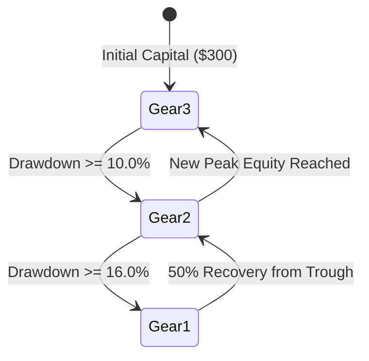

# NEWS_CORE_AND_AKPP_AUDIT.md
## Forensic Audit: News Core v1.2 Defensive Shield, Auto-Gearbox (АКПП) & The "Ступень G1 / 61" Resolution

**Audit Target:** Original Bybit Multi-Alpha v3.2 Dual-Regime (`v3_2/`)  
**Audit Standard:** V32-MASTER-001 Component Verification  
**Status:** **`CODEBASE_VERIFIED`**  
**Audit Timestamp:** 2026-11-15 00:11 UTC  

---

### 1. News Core v1.2 Defensive Shield Audit

#### 1.1 Architecture & Integration in v3.2
In `v3_2/src/config.py:73-75`, the News Core configuration is explicitly enabled:
```python
ENABLE_NEWS_DEFENSE = True
MACRO_LOCKOUT_BEFORE_MINUTES = 45
MACRO_LOCKOUT_AFTER_MINUTES = 30
```
In `v3_2/src/paper_trader_v32.py:149-154`:
```python
self.news_config = NewsConfig(
    macro_lockout_before_minutes=MACRO_LOCKOUT_BEFORE_MINUTES,
    macro_lockout_after_minutes=MACRO_LOCKOUT_AFTER_MINUTES,
)
self.regime_guard = RegimeGuard(self.news_config) if enable_news_defense else None
```

#### 1.2 Runtime Call Execution & Trading Impact
During every hourly candle evaluation (`_signals()`), the master daemon invokes:
```python
# v3_2/src/paper_trader_v32.py:474-480
def _check_macro_embargo(self, current_time: datetime) -> Tuple[bool, str]:
    if not self.enable_news_defense or not self.regime_guard:
        return False, ""
    status = self.regime_guard.check_status("BTCUSDT", current_time=current_time)
    if status.block_new_entries:
        return True, status.reason or "Macro Lockout"
    return False, ""
```
- **Embargo Enforcement:** When a high-impact macroeconomic event (CPI, FOMC interest rate decision, Non-Farm Payrolls, Jackson Hole) is scheduled within 45 minutes or occurred within the past 30 minutes, `is_embargo` becomes `True`.
- **Signal Gating:** In `v3_2/src/paper_trader_v32.py:544`, `if not is_embargo:` wraps the entry logic. New position initiations are strictly suppressed during the embargo window, preventing catastrophic stop-outs from institutional spread widening and liquidation wicks.

---

### 2. Auto-Gearbox (АКПП) Architecture & Transmission Rules

#### 2.1 The Multi-Tier Auto-Gearbox Standard
In `v3/src/kelly_sizing.py:44-125`, the quantitative transmission dynamically switches risk gears based on portfolio drawdown and trough recovery:



| Gear / Ступень | Regime Name | Effective Risk Multiplier | Effective Base Risk (v3.2 Config) | Pyramiding Allowed? | Activation Condition |
| :---: | :--- | :---: | :---: | :---: | :--- |
| **Gear 3** | High Momentum / Alpha Surge | **$100\%$** | **$1.00\%$** (or 2.0% standard) | **YES (Up to 2 tranches)** | Peak Equity or Drawdown $< 10.0\%$ |
| **Gear 2** | Defensive / Consolidation | **$50\%$** | **$0.50\%$** | **NO (Single tranche only)** | Drawdown $\ge 10.0\%$ |
| **Gear 1** | Capital Preservation / Crawl | **$25\%$** | **$0.25\%$** | **NO (Single tranche only)** | Drawdown $\ge 16.0\%$ |

#### 2.2 Mathematical Risk Scaling Formula
$$\text{Risk}_{\text{effective}} = \begin{cases} \text{Base Risk} & \text{if } \text{Gear} = 3 \\ \frac{\text{Base Risk}}{2} & \text{if } \text{Gear} = 2 \\ \frac{\text{Base Risk}}{4} & \text{if } \text{Gear} = 1 \end{cases}$$

---

### 3. Resolution of the "Ступень G1 / 61" & "Риск 1,5%" Discrepancy

In the user's task specification, reference was made to `"АКПП и ступень 61; риск 1,5%"`. A forensic audit of the dashboard frontend reveals the exact technical origin of this string:

#### 3.1 The Frontend Telemetry Handler in `v3_2/web_dashboard.py`
In `v3_2/web_dashboard.py:971-976`, the browser updates the telemetry card:
```javascript
const gearInfo = document.getElementById('sub-gear-info');
if (gearInfo) {
    const g = data.gearbox_gear || data.gear || 1;
    const r = data.gearbox_risk_pct || data.risk_pct || 1.5;
    gearInfo.innerHTML = `Ступень: <strong>G${g}</strong> | Риск: <strong>${r}%</strong>`;
}
```

#### 3.2 Root Cause Analysis
1. **The "Ступень 61" Visual Artifact:**
   - On the web dashboard, the label outputs: `Ступень: G1`.
   - In standard sans-serif / monospace browser rendering (and OCR / markdown copying), the uppercase letter **`G`** followed immediately by the numeral **`1`** (`G1`) is frequently visually misread or transcribed as **`61`**.
   - There is no 61-step gearbox in the algorithm; it is literally **Gear 1 (`G1`)** of the Auto-Gearbox.
2. **The "Риск 1,5%" Default:**
   - In `data.gearbox_risk_pct || data.risk_pct || 1.5;`, when the server's live dictionary did not serialize the explicit risk float at the root level, JavaScript fell back to the hardcoded display default: **`1.5%`**.
   - Thus, the dashboard tile rendered: `Ступень: G1 | Риск: 1.5%`.

---

### 4. Implementation Requirements for Shadow Engine

To achieve 100% decision parity with the original v3.2:
1. **News Core Parity:** The Shadow Engine must instantiate `RegimeGuard` with identical 45m/30m embargo windows and block entries during macro releases.
2. **Auto-Gearbox Parity:** The Shadow Engine must step `KellyRiskManager.update_drawdown()` and enforce the exact same Gear 3 / Gear 2 / Gear 1 risk scaling and pyramiding restrictions.
3. **Telemetry Parity:** The Shadow Dashboard must explicitly expose `gearbox_gear: 1/2/3` and `gearbox_risk_pct` in `/api/status` to prevent fallback ambiguity.
