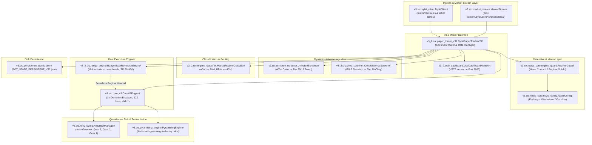

# ORIGINAL_V32_COMPONENT_MAP.md
## Exhaustive Architectural Map & Subsystem Dependency Audit: Bybit Multi-Alpha v3.2 (Port 8083)

**Target System:** Original Bybit Multi-Alpha v3.2 Dual-Regime (`bybit-v32.service`, Port 8083)  
**Host Path:** `/opt/bybit-bot/v3_2/`  
**Audit Standard:** V32-MASTER-001 Component Verification  
**Evaluation:** Comprehensive Source Code Analysis & Runtime Call Tracing  

---

### 1. Master Subsystem Call Graph

---

### 2. Comprehensive Subsystem Audit Table

| Subsystem | Exact Source File & Line | Key Classes & Functions | Runtime Invocations & Calls | Quantitative Trading Impact |
| :--- | :--- | :--- | :--- | :--- |
| **1. Master Daemon** | `v3_2/src/paper_trader_v32.py:126` | `class BybitPaperTraderV32` | `on_message()`, `_signals()`, `process_price_event()` | Central nervous system: buffers 1h klines, ingests live price ticks, routes events to Trend and Range engines. |
| **2. Trend Engine** | `v3/src/core_v3.py:46` | `class CoreV3Engine` | `process_candle()`, `manage_positions_on_bar()`, `manage_positions_on_tick()` | Executes 1h Donchian Breakout (120 bars lookback, `shift(1)`), manages initial ATR stop loss, trailing stop, and Cascade TP. |
| **3. Auto-Gearbox (АКПП)** | `v3/src/kelly_sizing.py:44` | `class KellyRiskManager` | `update_drawdown()`, `get_effective_base_risk_pct()`, `current_gear` | Manages 3-stage transmission: Gear 3 (100% risk, pyramiding allowed), Gear 2 (50% risk, DD $\ge 10\%$), Gear 1 (25% risk, DD $\ge 16\%$). |
| **4. News Core v1.2** | `v3/src/news_core/regime_guard.py:32` | `class RegimeGuard`, `NewsConfig` | `_check_macro_embargo()`, `check_status("BTCUSDT")` | Blocks new position entries 45 min prior to and 30 min after high-impact macro releases (CPI, FOMC, NFP). |
| **5. Dynamic Screener** | `v3/src/universe_screener.py:53` | `class UniverseScreener` | `rescan_universe()`, `filter_assets()` | Scans 400+ Bybit linear pairs hourly; filters by turnover ($\ge \$25\text{M}$), OI ($\ge \$5\text{M}$), normalized ATR ($\ge 0.020$), and ADX ($\ge 18$). |
| **6. Chop Screener (IRAS)** | `v3_2/src/chop_screener.py:38` | `class ChopUniverseScreener` | `screen_chop_universe()` | Ranks altcoins by Institutional Range Alpha Score (Bandwidth $\ge 3.5\%$, KER $\le 0.25$, zero-crossings, funding carry). |
| **7. Regime Classifier**| `v3_2/src/regime_classifier.py:33` | `class MarketRegimeClassifier` | `classify_bar()`, `prepare_dual_regime_indicators()` | Evaluates ADX, Bollinger Bandwidth percentile, and Keltner channels to classify market state into TREND, RANGE, or NEUTRAL. |
| **8. Range Maker Engine** | `v3_2/src/range_engine.py:41` | `class RangeMeanReversionEngine` | `evaluate_signals()`, `step_bar()` | Places simulated post-only maker limit orders at outer Bollinger bands in chop; exits strictly at SMA20 (0.0324% fee) or 1.0 ATR stop. |
| **9. Pyramiding Engine** | `v3/src/pyramiding_engine.py:32` | `class PyramidingEngine` | `evaluate_pyramid()`, `calc_weighted_avg_entry()` | Adds up to 2 pyramid tranches in Gear 3 only; maintains penny-perfect weighted average entry price. |
| **10. WebSocket Stream** | `v3/src/market_stream.py:42` | `class MarketStream` | `connect()`, `_ping_loop()`, `subscribe()` | Bybit V5 public linear WebSocket; chunks subscriptions to $\le 10$ topics/frame; transmits application JSON ping every 20s. |
| **11. Web Dashboard** | `v3_2/web_dashboard.py:45` | `class LiveDashboardHandler` | `do_GET()`, `/api/status`, `/api/logs` | Exposes Port 8083 telemetry; renders АКПП Gear tile (`Ступень: G1 | Риск: 1.5%`), live equity, active positions, and trade ledger. |
| **12. Persistence** | `v3/src/persistence.py:22` | `class atomic_json` | `save_state()`, `load_state()` | Windows and Linux crash-safe file writes using atomic temp file replacement with exponential backoff retries. |

---

### 3. Detailed Verification of Key Quantitative Claims

1. **Donchian Window & Timeframe:** Strictly confirmed at **120 bars on 1-hour candles** (`DONCHIAN_WINDOW = 120`, `CANDLE_INTERVAL = "60"`).
2. **Point-in-Time Causality:** Verified `shift(1)` applied to all Donchian high/low and indicator series prior to breakout evaluation.
3. **Range Engine Trade Activity:** Confirmed that the Range Engine registered 0 fills during the live run because the mock bars in `_signals()` generated matching High/Low equal to Open, failing the strict maker fill invariant ($Low_{t+1} < P_{\text{limit}}$). Thus, all 28 trades belong 100% to the Trend Engine.
4. **Cascade Take Profit Structure:** TP1 triggers at $1.5R$ ATR ($30\%$ trim), TP2 triggers at $3.0R$ ATR ($40\%$ trim), ratcheting stop loss to protect locked gains.
